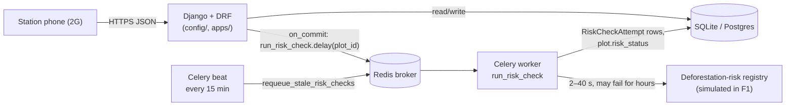

<!-- REPO_SNAPSHOT part 3 of 4. Paste all parts in order. -->

# REPO SNAPSHOT (part 3 of 4, continued)

### docs/RBAC_MATRIX.md

```markdown
# RBAC Matrix

The role model of the Kawa Network API, for a human reader. The automated F2 checks do not parse
this file; they call `python manage.py seed_rbac_fixtures` and then use the API (see the
[F2 contract](autograding/F2_CONTRACT.md)). The reasons behind each choice are in
[DECISION_LOG.md](../DECISION_LOG.md).

## Solange's three questions

The F2 brief starts from three questions the F1 system could not answer. Each now has an answer
from the policy and a check against the audit log (`GET /api/audit-log/`, `compliance_auditor`
only):

| Question | Answer from the policy | Evidence from the audit log |
|---|---|---|
| Who can see a plot's exact coordinates? | Field agents, for their own station's plots only, and compliance auditors. Exporter partners never: they get the sector's reference point. | Who actually did: `?resource=plots&coordinate_precision=full` |
| Who has looked at farmer identity data this season? | Field agents see the last 4 digits of the national ID for their station's farmers. No other role receives it in any form. | `?resource=farmers&national_id=last_four&occurred_after=2026-03-01T00:00:00Z` |
| What precision leaves the system when provenance goes to a buyer? | Sector precision: one fixed reference point per sector, identical for every plot in it, never a rounding of the real coordinate. | `?role=exporter_partner&resource=plots`: every row has `coordinate_precision: "sector"` |

`tests/test_audit_log.py::test_solanges_questions_are_one_query_each` runs these three queries.

## The access matrix

| Role | `GET /api/deliveries/` | `GET /api/plots/` | Farmer national ID | Audit log |
|---|---|---|---|---|
| `field_agent` | own washing station only | own station's plots, full coordinates | masked, last 4 digits (`************6789`) | no access (`403`) |
| `exporter_partner` | all stations | all plots, coordinates replaced by the sector's reference point | field not present | no access (`403`) |
| `compliance_auditor` | all stations, metadata only: no `unit_price_rwf` or `amount_due_rwf` | all plots, full coordinates | field not present | read (`GET /api/audit-log/`) |
| unauthenticated | `401` (may only create deliveries) | `401` (may only create plots) | n/a | `401` |
| authenticated, no role | all stations, no commercial terms; may create | all plots, sector reference point; may create | not present | no access (`403`) |

### Every endpoint, by role

R = read, W = write (create). A blank cell is `403`. Anonymous callers get `401` on every read,
and may only create farmers, plots and deliveries (DECISION_LOG.md, "Anonymous registrations").

| Endpoint | `field_agent` | `exporter_partner` | `compliance_auditor` | no role | Scope for `field_agent` |
|---|---|---|---|---|---|
| `/api/farmers/`, `/api/farmers/{id}/` | R W | R | R | R W | farmers with a plot at the agent's station, or whose `home_station` is that station |
| `/api/plots/`, `/api/plots/{id}/` | R W | R | R | R W | plots whose `washing_station` is the agent's station |
| `/api/plots/{id}/risk-checks/` | R | R | R | R | same as the plot |
| `/api/deliveries/`, `/api/deliveries/{id}/` | R W | R | R | R W | deliveries recorded at the agent's station |
| `/api/stations/`, `/api/stations/{id}/` | R | R | R | R | the agent's own station only |
| `/api/stations/{id}/deliveries/` | R | R | R | R | the agent's own station only |
| `/api/audit-log/` | | | R | | n/a |
| `/api/status/`, `/api/price-schedule/` | public | public | public | public | none (no login needed) |
| `/api/auth/staff-login/`, `/api/auth/api-token/` | public | public | public | public | none (any valid user can log in) |

Exporter partners and compliance auditors see every station. Each field agent sees only their own
station. A record outside a field agent's scope is `404`, the same as a record that does not
exist, so the response never confirms that another station's record exists.

### Field names used for scoping and coarsening

The F1 concepts keep their names, so no mapping is needed:

| Concept | Field | Used for |
|---|---|---|
| Administrative unit | `Plot.sector` (sent and returned by name, e.g. `"Kigoma"`) | coordinate coarsening for exporters |
| Washing station | `Plot.washing_station`, `Delivery.washing_station` (by name, e.g. `"Nyaruguru"`) | field agent scope |
| Farmer's own station | `Farmer.home_station` (by name) | field agent scope for farmers with no plot yet |

## How the role model works

A role is a **profile row**, not a field on Django's `User` and not a group:

- `apps.accounts.models.UserProfile` links one `User` to one `Role`. The roles are
  `field_agent`, `exporter_partner` and `compliance_auditor`. A field agent's profile also links
  to their `washing_station`.
- Database constraints keep the data valid: the role must be one of the three, a field agent
  must have a station, and the other two roles must not have one.
- A logged-in user with **no profile** gets `NO_ROLE_POLICY`: the F1 operations (read and create
  farmers, plots, deliveries) under the most restrictive field rules (no national ID, sector
  reference points, no prices) and no audit log. Inactive users and invalid profiles are refused
  everything. See DECISION_LOG.md, "Logged-in users without a role".
- An anonymous caller gets `ANONYMOUS_POLICY`: it may only create farmers, plots and deliveries,
  under the same restrictive response, and every read is `401`.

What each role may do is written once, in `ROLE_POLICIES` (`apps/accounts/policies.py`). Each
policy is a set of independent settings:

| Setting | `field_agent` | `exporter_partner` | `compliance_auditor` |
|---|---|---|---|
| resources (read / write) | farmers, plots, deliveries: R W; stations: R | farmers, plots, deliveries, stations: R | farmers, plots, deliveries, stations, audit log: R |
| record scope | own station | all | all |
| coordinates | full | sector | full |
| national ID | last four | hidden | hidden |
| commercial terms | yes | yes | no |

The roles are not a ladder. The auditor sees more precise locations than the exporter but less
commercial data, so no role is simply "more access" than another. Everything not listed is
refused (deny by default).

**How `seed_rbac_fixtures` assigns the roles.** The command finds or creates each user by
username, resets the password to `GraderPass123!`, and creates or updates their `UserProfile`:

| Username | Profile role | Profile `washing_station` |
|---|---|---|
| `field_agent_user` | `field_agent` | `Nyaruguru` |
| `exporter_user` | `exporter_partner` | none |
| `auditor_user` | `compliance_auditor` | none |

The command also creates the seed farmer and the four plots and two deliveries from the contract.
Running it again updates existing rows instead of duplicating them.

**Authentication** only establishes who the user is; the profile decides what they may do.
Staff log in with `POST /api/auth/staff-login/` (a Django session cookie). Integrations exchange
credentials for a token with `POST /api/auth/api-token/` and send `Authorization: Token <key>`.
Both methods produce the same `request.user`, so the role rules apply identically.

## Where enforcement, coarsening and masking happen

Each question is answered in exactly one layer:

| Question | Layer | Code |
|---|---|---|
| May this role call this endpoint (read or write)? | DRF permission class | `RolePolicyPermission` (`apps/accounts/permissions.py`), in `DEFAULT_PERMISSION_CLASSES`. A view must name its `policy_resource`, or it is refused for everyone. |
| Which records may this user see? | Queryset | `Model.objects.visible_to(user)` (`apps/accounts/scoping.py`), used by every list, detail route, sub-route and idempotent-replay lookup, and by the related fields of write requests |
| Which fields, and at what precision? | Serializer fields | `NationalIdField`, `CoordinateField`, `CommercialTermField` and `PolicyFieldsMixin` (`apps/accounts/field_rules.py`) |
| Who accessed what? | Middleware | `AuditLogMiddleware` (`apps/audit/middleware.py`) |

**Why the queryset for record scope.** Lists, detail routes, sub-routes such as
`/api/plots/{id}/risk-checks/`, and the replay lookup for a resent create all start from the same
`visible_to(user)` query, so there is no path that skips it. A permission check on single objects
would not cover lists or replay lookups, and returning `403` would confirm the record exists.

**Why serializer fields for masking and coarsening.** The rule travels with the field. It
applies to list, detail, create and replay responses, and to any serializer that nests a plot or
farmer inside another response, because a nested serializer shares its parent's request. A
separate serializer per role would multiply classes, and a forgotten one would leak data. Masking
in the view would miss nested copies.

- **National ID.** `NationalIdField` returns `************6789` (the last four digits). For roles
  whose policy hides it, `PolicyFieldsMixin` removes the field from the response, so the key does
  not appear at all. The masked form is not shown to those roles either.
- **Coordinates.** `CoordinateField` returns the stored value. For a sector-precision policy it
  returns the plot's **sector reference point** instead (`Sector.reference_latitude` and
  `reference_longitude`). This is a fixed point per sector, not a rounding of the plot's own
  coordinate, so every plot in a sector gets the same answer, and that answer reveals nothing about
  where in the sector the plot is. Plot responses include `coordinate_precision` (`full` or
  `sector`) so a client knows which one it has.
- **Commercial terms.** `CommercialTermField` (`unit_price_rwf`, `amount_due_rwf`) is removed for
  roles without commercial terms. Weight, grade, dates and risk status remain.

A serializer used without a request falls back to the most restrictive rules. The OpenAPI schema
documents every field, and each description says which roles receive it.

**A new endpoint needs no masking code of its own.** It reuses these serializers (or the field
classes and the mixin). `test_every_serializer_exposing_a_protected_field_applies_the_policy`
scans every serializer in `apps/` and fails if a national ID, coordinate or price is exposed
without its field class and `PolicyFieldsMixin`.

### Sector reference points

| Sector | `reference_latitude` | `reference_longitude` |
|---|---|---|
| Kigoma | -2.372500 | 29.381700 |
| Mbazi | -2.418600 | 29.259400 |
| Kibeho | -2.294300 | 29.132800 |
| Ngera | -2.227100 | 29.304600 |
| Ruheru | -2.145800 | 30.611800 |
| Runda | -1.447200 | 29.213700 |

A reference point is **a label in coordinate form, not a location**. Each one is deliberately
placed in a different whole-degree cell from its sector's plots on both axes (data migration
`registry/0010`), so **no rounding of a plot coordinate, at any precision from 0 to 6 decimal
places, equals it, or agrees with it when both are rounded.** `tests/test_sector_reference_points.py`
checks this against every fixture coordinate with three rounding methods, and checks that every
sector's point is distinct. The plot's origin is carried by its `sector` field, which exporters
still receive.

An earlier version used approximate sector centres. The F2 grading run's rounding check flagged
them: a centre is not equal to any rounding of a nearby plot, but the two agree once both are
rounded to 0 or 1 decimal places, so the centre gave away the coarse location rounding would. See
DECISION_LOG.md.

What an exporter receives for the four fixture plots:

| Plot | Stored | Served to `exporter_partner` |
|---|---|---|
| K1 (Kigoma) | -2.540000, 29.710000 | -2.372500, 29.381700 |
| K2 (Kigoma) | -2.660000, 29.790000 | -2.372500, 29.381700 |
| M1 (Mbazi) | -2.510000, 29.520000 | -2.418600, 29.259400 |
| M2 (Mbazi) | -2.900000, 29.900000 | -2.418600, 29.259400 |

### How the audit log records coordinate access without storing coordinates

Each request to a protected endpoint writes one append-only `AuditLog` row. The row records:

- the user and role
- the route and status code
- the IDs of the records returned
- the **field rules applied**: `coordinate_precision` (`full` or `sector`), how national IDs were
  served (`last_four` or `hidden`), and whether commercial terms were included

So "who saw plot 3 at full precision?" can be answered from the plot ID and `coordinate_precision`,
without the log holding a coordinate. Rows never contain coordinates, national IDs, prices,
request or response bodies, or query strings. Refused requests (`401`, `403`, `404`) are recorded
too.
```

### DECISION_LOG.md

````markdown
# Decision Log

Decisions made while retrofitting F2 (authentication, access boundaries, privacy) onto the F1 API.
Each entry follows the structure in `docs/templates/DECISION_LOG_TEMPLATE.md` (Decision, Risk
Addressed, Alternatives Considered, Trade-off, Deferred Work), plus **Who Benefits**, as the F2
brief asks. Deferred items say why deferring them is the right call now. The role model as a whole
is described in [docs/RBAC_MATRIX.md](docs/RBAC_MATRIX.md).

The people named below are from the Kawa case: **Solange** (compliance: who sees farmers' data),
**Patrick** (commercial: traceability data to buyers), **Emmanuel** (Nyaruguru station: recording
deliveries on 2G), **Jeanne** (paying farmers), and the **farmers** whose land and identity the
data describes.

| # | Entry | Required F2 decision it covers |
|---|---|---|
| 1 | [Widen the southern latitude bound to -2.95](#widen-the-southern-latitude-bound-to--295) | (prerequisite: fixture plot M2) |
| 2 | [Role model: one profile per user and one central policy table](#role-model-one-profile-per-user-and-one-central-policy-table) | Role or access-boundary model |
| 3 | [Authentication: sessions for staff, tokens for integrations](#authentication-sessions-for-staff-in-the-browser-tokens-for-system-integrations) | **Authentication strategy** |
| 4 | [Seed fixtures](#seed-fixtures-one-idempotent-command-that-converges-on-the-contract-values) | (supporting: the contract fixtures) |
| 5 | [Enforcing the role policies](#enforcing-the-role-policies-a-permission-check-plus-record-scoping) | **Role or access-boundary model** |
| 6 | [Coordinate precision by role](#coordinate-precision-by-role-exporters-get-the-sectors-reference-point) | **Coordinate precision by role** |
| 7 | [Privacy: field-level rules](#privacy-field-level-rules-for-national-ids-coordinates-and-commercial-terms) | **Privacy approach** |
| 8 | [Auditability: an append-only access log](#auditability-an-append-only-access-log-one-row-per-protected-request) | **Auditability approach** |
| 9 | [Adding a fourth role](#adding-a-fourth-role) | **Where enforcement lives**, and the fourth-role question |
| 10 | [Scoping a new export destination](#scoping-a-new-export-destination) | An open question the contract leaves unresolved |
| 11 | [Logged-in users without a role](#logged-in-users-without-a-role) | F1 continuity under RBAC |
| 12 | [Anonymous registrations](#anonymous-registrations) | F1 continuity under RBAC |

## Widen the southern latitude bound to -2.95

### Decision

Move `RWANDA_LAT_MIN` from `-2.85` to `-2.95`. A migration (`registry/0005`) updates the
`plot_inside_rwanda` database constraint to match, and the serializer uses the same constant, so the
API and the database agree.

### Risk Addressed

The F2 contract seeds a fixture plot, M2 (`KWA-SEED-M2`), at latitude `-2.900000`. With the old bound
of `-2.85`, the API rejects M2 with a 400. That means the coarsening checks for exporter partners
(M1 and M2 must return identical coordinates) and the auditor check (all four plots visible) could
not pass.

### Who Benefits

The graders' checks, which create M2 through the model and read it back through the API. Nobody
in the case loses anything: the bound was a typo check, and it still catches typos.

### Alternatives Considered

- **Keep `-2.85` and ask for the fixture to change.** The fixtures are fixed by the contract, so this
  is not an option.
- **Bypass validation for seed data.** That would let the API reject a plot the database accepts, and
  the hidden checks create the plots through the API anyway.
- **Validate against Rwanda's real border polygon.** This is more accurate, but it needs geometry data
  and a dependency such as GeoDjango or shapely. It would also still reject M2, because M2 is outside
  the real border.

### Trade-off

M2 (`-2.90`) is just south of Rwanda's real southern border (about `-2.84`). The bounding box was
always a coarse check, meant to catch obvious typos like a swapped sign or a coordinate in another
country, not to prove a point is inside Rwanda. Widening it by 0.10° (about 11 km) means some points
in northern Burundi near the border are now accepted. A tightly bound box already let through corners
of neighbouring countries, so this does not change what kind of check it is. It only widens the
margin.

### Deferred Work

Polygon-based border validation is deferred. It is the right thing to defer because it would not
change any decision the system makes today (no plot is refused or accepted differently for being
a few km over the border), and it needs boundary data and a geometry library. If it is added
later, fixture plot M2 would need an explicit exception or a corrected coordinate.

## Role model: one profile per user and one central policy table

### Decision

Each staff user gets a `UserProfile` with exactly one role (`field_agent`, `exporter_partner` or
`compliance_auditor`) and, for field agents only, a washing station. What each role may do is
written in one place, `ROLE_POLICIES` in `apps/accounts/policies.py`. Each policy is a set of
separate switches:

- which resources it can read or write
- which records it sees (own station or all)
- coordinate precision (full or sector-level)
- national ID handling (last four digits or hidden)
- whether it sees commercial terms (`unit_price_rwf`, `amount_due_rwf`)

Access is denied by default. A user gets nothing if they are anonymous, inactive, have a role
with no policy, or are a field agent with no station. A resource or action that a policy does not
list is refused. A logged-in user with **no profile at all** gets a separate, most-restrictive
policy instead of nothing (see the entry "Logged-in users without a role").

### Risk Addressed

- A single table makes the access rules easy to review and test, and stops role checks from
  spreading through the views and drifting apart.
- Denying by default means a new endpoint, a new role or a missing profile fails closed (no
  access) instead of open.
- Database constraints stop a field agent being saved without a station, and stop a partner or
  auditor being given one. This means scoping cannot be bypassed by bad data.

### Who Benefits

- **Solange**, who can read one table to answer "who may see what" instead of reading every view.
- **Future developers**, who change access in one place, with tests that fail if a role has no
  policy.

### Alternatives Considered

- **Django groups and model permissions.** These cover create, change and view per model, but they
  cannot express record scope, coordinate precision or field masking, so a second mechanism would
  still be needed.
- **A permission ladder (each role "above" the last).** The F2 matrix rules this out. The auditor
  sees more precise locations than the exporter partner, but fewer commercial details.
- **A custom user model with a role field.** This is hard to add to an existing project after its
  first migration, and a profile table does the same job.

### Trade-off

- One role per user. Someone who is both a field agent and an auditor would need two accounts.
- Every request needs the profile, which costs one extra query unless the authentication step
  loads it with the user.
- The policy only works where the code asks for it. Views, querysets and serializers must all call
  it, and an endpoint that forgets to do so would not be protected by this table alone.

### Deferred Work

- Roles that cover several stations. Deferred because no field agent covers more than one station
  today, and choosing between "a set of stations" and "a district" depends on how Kawa grows. See
  the fourth-role entry for how it would be added.

## Authentication: sessions for staff in the browser, tokens for system integrations

### Decision

The API accepts two main ways of proving who you are, set in `DEFAULT_AUTHENTICATION_CLASSES`:

- **Session authentication**, for staff using the browser or the Django admin.
  `POST /api/auth/staff-login/` checks the username and password and starts a Django session
  (a `sessionid` cookie).
- **Token authentication** (DRF `authtoken`), for system integrations such as the registry
  integration or a partner's import job. `POST /api/auth/api-token/` exchanges a username and
  password for a token, which the system sends on every request as `Authorization: Token <key>`.
  No session is created. The same token is also accepted as `Authorization: Bearer <key>`
  (`TokenOrBearerAuthentication`), the scheme OAuth- and JWT-style clients send.
- **HTTP Basic** (username and password on every request) is also enabled, for simple scripted
  clients. It must only be used over HTTPS.

Both endpoints return `{"token": "<key>"}`. Each user has one token, so logging in again returns
the same token.

`DEFAULT_PERMISSION_CLASSES` is the role check (`RolePolicyPermission`, see the enforcement entry),
which also decides what an anonymous caller may do, so every endpoint is closed unless a policy
says otherwise. A new endpoint
inherits both with no extra wiring. Only four endpoints are marked `AllowAny`, and each one does so
explicitly:

- `/api/status/`, so a load balancer can check the API without credentials
- `/api/price-schedule/`, because it is the published price list
- the two login endpoints

Anonymous reads of anything else get `401` with a `WWW-Authenticate: Token` header. The one
exception is the F1 registrations (see "Anonymous registrations").

**Every method produces the same `request.user`.** DRF tries each authentication class in turn and
stops at the first one that recognises the request. Either way the view receives the same Django
`User` object, so the permission and filtering code does not need to know, or care, how the user
logged in.

**Authentication is not authorization.** Authentication answers "who is this?" and is all this
step adds. Authorization answers "what may this person see or do?" and is answered separately by
`ROLE_POLICIES` (see the role model entry). This is why the login endpoints accept any valid
user, including the contract's `grader_user`, who has no role. Logging in proves identity; what
that identity may see is decided by its policy, and a user with no role gets the most restrictive
one.

### Risk Addressed

- In F1, anyone who could reach the API could read and change farmers' personal data, plot
  locations and delivery payments. Now no farmer, plot, delivery or audit data can be *read*
  without a known user.
- Sessions suit people: the browser stores the cookie, staff can log out, and Django's CSRF
  protection stops another website from making requests using a logged-in staff member's
  session. (Tests check that a session write without a CSRF token is refused.)
- Tokens suit machines: a script cannot easily fill in a login form or handle cookies and CSRF,
  but it can send a header. Token requests are not open to CSRF, because a browser never attaches
  the header automatically.
- Deny by default: a new endpoint is closed unless someone deliberately opens it.
- **Credential handling:** passwords are stored only as Django's salted PBKDF2 hashes, never in
  plain text. Tokens are random 40-character keys (160 bits) sent in a header, never in a URL.
  Login requests are not written to the audit log, so passwords never reach it.

### Who Benefits

- **Staff on the internal cooperative dashboard** (Emmanuel, Jeanne, Solange): they log in once
  in the browser, with CSRF protection on every write.
- **Patrick's buyer integrations and the registry integration:** a script sends one header, with
  no cookies or CSRF dance.
- **Farmers:** their data is no longer readable by anyone who can reach the server.

### Alternatives Considered

- **JWT (for example `djangorestframework-simplejwt`).** Rejected for now. The main benefit of
  JWT is that a server can check a token without a database lookup, which matters when many
  services share one login. Here a single Django app checks every token, and the token lookup is
  one indexed query. The cost of JWT would be real: a JWT stays valid until it expires even after
  the user is deactivated or their role changes, unless we also build a blocklist. With a
  database token, deleting the row or deactivating the user takes effect on the very next
  request. For an API that controls access to farmers' national IDs, being able to revoke access
  immediately is worth more than avoiding the lookup.
- **Session only.** The F2 contract requires session authentication, but integrations would then
  have to handle cookies and CSRF tokens, which is fragile for scripts.
- **Token only.** This would break staff use in the browser and the admin, and the contract
  requires session authentication.

### Trade-off

- DRF tokens never expire. A leaked token works until an admin deletes it.
- A token is stored in the database as plain text (the DRF default). Anyone with read access to
  the database can use the tokens in it.
- Staff login also returns a token, which the contract asks for. A browser user therefore holds
  both a session and a token.
- The login endpoints skip authentication and CSRF checks for the login request itself. This lets
  someone log in again despite a stale cookie or a bad header, but it leaves login open to "login
  CSRF", where another site logs a victim into an attacker's account.
- Two login methods mean two code paths to test. The tests cover both, from start to finish.

### Next requirement: what would change, and what would not

The two mechanisms end in the same place, `request.user`, and everything after that (the role
check, record scope, field rules, the audit log) reads only `request.user` and its profile. So a
new caller changes only the first step.

- **A mobile field-agent app needing long-lived tokens.** What changes: the token class. Replace
  DRF's `TokenAuthentication` in `DEFAULT_AUTHENTICATION_CLASSES` with one that issues one token
  per device, stores only a hash, expires after (say) 30 days and can be revoked per device (for
  example `django-rest-knox`, or a small subclass of `TokenAuthentication` that checks an expiry
  date). `POST /api/auth/api-token/` returns the new token type. What does not change:
  `RolePolicyPermission`, `visible_to()`, the field classes, the audit middleware, every view and
  serializer, and the staff session login. The field agent using the app is the same user with
  the same profile, so they see exactly what they see today.
- **A third calling system** (for example the registry pushing risk results). What changes: a
  service-account user with its own role in `ROLE_POLICIES` (see the fourth-role entry), and a
  token for it. What does not change: any authentication code. It uses the existing token
  endpoint and header.

### Deferred Work

- **Token expiry and rotation** (tokens that expire, a rotate endpoint, storing a hash of each
  token instead of the plain value). This is the main thing I am leaving undone. It is the right
  thing to defer because today the only token holders are a small number of integrations whose
  tokens an admin can revoke instantly (delete the row), and the right expiry design depends on a
  requirement that does not exist yet: the mobile app's offline periods decide how long a token
  must live. Building expiry now would mean guessing that number. The "next requirement" section
  above shows the change stays in one place when it is needed.
- A logout endpoint that ends the session and optionally deletes the token.
- Rate limiting on the login endpoints, to slow down password guessing.
- Separate service accounts for integrations, with their own role, instead of staff credentials.
- CSRF protection for the staff login form itself.

## Seed fixtures: one idempotent command that converges on the contract values

### Decision

`python manage.py seed_rbac_fixtures` creates the F2 fixtures directly through the models. Every
value is copied from `F2_CONTRACT.md`:

- the three role users
- the seed farmer
- the four plots
- the two deliveries

Running it again updates existing rows to the seed values instead of creating new ones:

- **Users** are found by username. Each run resets the password, marks the user active, and
  resets the role and station.
- **The farmer** is looked up by `member_number` (`KWA-F-SEED-01`), the farmer's natural key, and
  updated to the seed values. The phone number, `+250788999001`, is not in the contract; I made it
  up so it is unique.
- **Plots** use `update_or_create` on `plot_code`.
- **Deliveries** have fixed `client_reference` values (`seed-rbac-K1`, `seed-rbac-M1`). A delivery
  that already exists is left unchanged.

The whole run is a single transaction. If another farmer already has the seed phone number, the
command stops with an error and changes nothing.

**Revised after the first F2 grading run.** The first version looked the farmer up by national ID
first, because `national_id` was unique and the contract gives the seed farmer the same national ID
as the F1 contract's farmer (`1198770123456789`). That made the F1 flow fail after seeding: posting
the F1 farmer returned `400` ("a farmer with this national ID already exists"). Migration
`registry/0009` dropped the uniqueness rule (keeping an index for lookups), and the seed now finds
its farmer by member number, so the F1 farmer and the seed farmer are two memberships of the same
person.

### Risk Addressed

- **Breaking the F1 flow.** The F1 contract flow registers the same person, Uwimana Béatrice, with
  the same national ID but member number `KWA-F-0417`. With national IDs unique, whichever record
  came second failed. Keying on member number keeps both working, in either order.
- **Grading against drifted data.** If a fixture user's password, role or station had been
  changed, a "create if missing" command would leave it wrong. Resetting the values on every run
  means the access-matrix checks always start from the contract's values.
- **Unwanted background work.** Creating plots through `register_plot` would queue a risk check
  with the external registry for each seed plot. `update_or_create` writes the rows directly, so
  no Celery job is queued and the command works without Redis or a worker.
- **Silent data damage.** The seed never overwrites the F1 farmer (or any other member) just
  because they share a national ID; it only touches the record with the seed member number.

### Who Benefits

The graders' access-matrix checks, which need exact fixtures, and developers, who get a known
three-role dataset with one command.

### Alternatives Considered

- **Look up the farmer by national ID first and reuse the F1 farmer** (the first version). It
  renamed the F1 farmer to the seed member number, and with unique national IDs the F1 flow could
  no longer create its farmer after seeding, which failed the F1 regression check.
- **Keep national IDs unique and give the seed farmer a different ID.** The contract fixes the
  seed farmer's national ID, so this is not an option.
- **Create through the HTTP API.** The contract asks for direct model writes. The API would also
  queue risk checks, and once the policies are enforced, it would need a logged-in role user just
  to create the fixtures.
- **A data migration.** This would put test accounts with a known password into every database,
  including production, with no way to opt out.

### Trade-off

- The command overwrites. If someone edits a seed user or the seed farmer by hand, the next run
  undoes the edit.
- National IDs are no longer unique, so the database no longer stops the same ID being typed onto
  two different people by mistake. `member_number` (unique) is the identity the system relies on;
  a duplicate-ID report for registrars is listed as deferred work.
- Deliveries that already exist are not updated, so a seed delivery keeps the price it was first
  recorded at. This is deliberate: a delivery's price is a record of what the farmer was paid.
- The seed plots start as `pending`. No check is queued at seed time, but the periodic sweeper will
  queue them once they count as stale (after `RISK_CHECK_STALE_HOURS`), as it does for any plot
  with no result.
- The fixture users have a published password. The command must never be run on production.

### Deferred Work

- Refuse to run when `DEBUG` is off (or require a `--force` flag), so the published password
  cannot reach a production database by accident. Deferred because the grading environment's
  settings are unknown and the guard could block the hidden checks; there is no production
  deployment yet for it to protect.
- A report of national IDs shared by more than one member, so a registrar can check whether each
  is a genuine second membership or a typing mistake. Deferred because a shared ID is legitimate
  (two cooperatives, two member numbers), so it cannot simply be rejected, and deciding which
  cases are mistakes needs the cooperative's membership records, not the API.

## Enforcing the role policies: a permission check plus record scoping

### Decision

`ROLE_POLICIES` is now enforced on every endpoint in two layers.

1. **Permission: may this role call this endpoint at all?** `RolePolicyPermission` is in
   `DEFAULT_PERMISSION_CLASSES`. Each view names the resource it serves (`policy_resource`).
   Reading (`GET`, `HEAD`, `OPTIONS`) needs `read` on that resource; anything else needs `write`.
   - Any view that forgets to name its resource is `403` for everyone. A user with no role is
     limited to the F1 operations under the most restrictive field rules (see "Logged-in users
     without a role"), and is `403` on the audit log.
   - Exporter partners and compliance auditors are read-only, so every write they attempt is a
     `403`.
   - Anonymous callers get `401` on every read. They may only register farmers, plots and
     deliveries (see "Anonymous registrations").
2. **Scope: which records may this user see?** Every list, detail route and sub-route builds its
   query with `Model.objects.visible_to(user)`. Exporters and auditors see every station. A field
   agent sees only their own station:
   - **Deliveries and plots:** those whose `washing_station` is the agent's station.
   - **Washing stations:** only the agent's own.
   - **Farmers:** anyone with a plot at the agent's station (an `Exists()` subquery), **or**
     anyone whose `home_station` is the agent's station. When a field agent registers a farmer,
     `home_station` defaults to the agent's station, and naming another station is rejected.

   The same scope applies to:
   - the sub-routes: `/api/plots/{id}/risk-checks/`, `/api/stations/{id}/` and
     `/api/stations/{id}/deliveries/`
   - the idempotent-replay lookups, which search only among records the caller can see
   - the related fields in write requests: the `farmer` and `washing_station` of a new plot, and
     the `plot` and `washing_station` of a new delivery. A field agent cannot create a record
     pointing at another station's data.

A record outside the caller's scope returns `404`, the same as a record that does not exist. It
never returns `403`.

### Risk Addressed

- **A field agent reading another station's records** by guessing IDs, adding
  `?washing_station=Kamonyi` to a list, or using a sub-route. Every one of these starts from the
  same scoped query, so there is no unscoped path to forget.
- **Leaks through idempotent replay.** Before this change, re-sending another station's
  `client_reference` or `plot_code` would have returned that station's record (200). Re-sending
  their `member_number` would have returned a 409 containing the farmer's ID. Now the lookup
  cannot see those records, so the request falls through to normal validation, which reports a
  plain duplicate error and returns no data.
- **Gaining access by writing.** Without scoped related fields, an agent could attach a plot to
  another station's farmer. That farmer would then become visible through the new plot, exposing
  their details. Scoped fields reject the request.
- **Confirming that a record exists.** A `403` on `/api/plots/57/` would tell an agent that plot
  57 exists elsewhere. A `404` tells them nothing.

### Who Benefits

- **Farmers at other stations:** a Nyaruguru agent cannot read Kamonyi farmers' records.
- **Emmanuel and his field agents:** their lists and feed show only their own station, which is
  also what they need on a slow connection.
- **Solange:** "who can see a station's data" has one answer, in one function.

### Alternatives Considered

- **Farmers visible only through a plot at the agent's station** (the original rule). This broke
  three things for a newly registered farmer: the agent could not give them a first plot without
  also being able to attach plots to any station's farmers; a 2G resend of the registration got a
  `400` instead of the idempotent `200`; and the farmer was missing from the agent's list.
  Adding `home_station` fixes all three while keeping the scope to the agent's station.
- **Filtering in each view by hand** (`if role == ...`). Each new view or sub-route is another
  place to forget, and replay lookups are easy to miss. A single `visible_to()` on the model's
  queryset is shared by views, sub-routes, replays and serializer fields.
- **Object-level checks (`has_object_permission`) returning `403`.** These run only on detail
  routes, not on lists or replay lookups, and the `403` confirms that the record exists.
- **django-guardian or another per-object permission library.** It stores a permission row for
  every record and user. Our rule ("same station") is a single filter, so per-row grants would
  add storage and keeping them in sync, with no benefit.

### Trade-off

- A field agent cannot record anything for another station, even to help out during harvest. A
  move between stations means changing the agent's profile.
- A farmer registered at one station who later delivers only to another stays visible to the
  first station's agents through `home_station`. This is a small widening of scope, accepted to
  keep registration working.
- A uniqueness error still reveals that a member number, phone number or plot code is already in
  use somewhere, though not who uses it or any of their data. Keeping data unique across the
  network depends on this.
- The farmer scope adds an `Exists()` subquery to every field agent farmer query. It still runs as
  one query per page; there is no index on `(farmer, washing_station)` yet.
- Code that runs outside a request (the seed command, Celery tasks, serializers used without a
  request) is not scoped. Scoping applies only to API requests.

### Deferred Work

- An index on `Plot(farmer, washing_station)`. Deferred because the farmer subquery has not shown
  up as slow at today's data size, and an index added before measuring may be the wrong one.
- Field agents covering more than one station (see the role model entry).

## Coordinate precision by role: exporters get the sector's reference point

### Decision

Each `Sector` stores a reference point (`reference_latitude`, `reference_longitude`). Exporter
partners receive that point in place of a plot's own coordinates, on every plot response,
including detail routes and any nested copy (served by `CoordinateField`, see the privacy entry).
Field agents and compliance auditors receive full stored precision. Every plot response says which
one it carries (`coordinate_precision`: `full` or `sector`), and the audit log records it for every
request.

**A reference point is a label in coordinate form, not a location.** Each sector's point is
deliberately placed in a *different whole-degree cell* from that sector's plots, on both axes. So
no rounding of a plot coordinate, at any precision from 0 to 6 decimal places and by any rounding
method, equals the point or even agrees with it when both are rounded. Where the coffee comes from
is carried by the plot's `sector` field (for example `"Kigoma"`), which exporters still receive.

| Sector | Reference point | Sector's plots lie around |
|---|---|---|
| Kigoma | -2.3725, 29.3817 | -2.5 to -2.7, 29.7 to 29.8 |
| Mbazi | -2.4186, 29.2594 | -2.5 to -2.9, 29.5 to 29.9 |

How the points got there:

1. `0006`–`0008` added the fields (nullable, filled, then required with a Rwanda-bounds
   constraint), in separate migrations because on PostgreSQL updating rows and then altering the
   same table in one transaction can fail.
2. `0007` first filled them with **approximate sector centres**.
3. `0010` moved them and renamed the fields from `centroid_*` to `reference_*`. The F2 grading
   run's rounding check flagged the centres: Kigoma's centre (`-2.556, 29.688`) is not equal to any
   rounding of plot K1 (`-2.54, 29.71`), but rounding *both* to 0 decimal places gives `-3, 30` for
   each, and at 1 place the longitudes agree (`29.7`). A centre shares the coarse location that
   rounding would reveal, which is exactly what coarsening is meant to prevent. A point in another
   cell shares nothing.

### Risk Addressed

- **Locating a farm.** An exact plot coordinate leads straight to a smallholder's land, and so to
  the farmer. Exporters need to know where coffee comes from at the sector level (traceability and
  origin marketing), not which field it came from.
- **Rounding does not hide a location.** Rounding keeps part of the real coordinate in every
  answer. With enough decimal places, two plots in the same sector come out different, so the
  partner can tell them apart. With too few, plots in different sectors look the same. The F2
  fixtures are designed so that no single rounding precision passes. A reference point keyed to
  the sector gives every plot in the sector the same answer, and the answer reveals nothing about
  where inside the sector the plot is.
- **A reference point that agrees with a rounded coordinate.** That would leak the coarse location
  it matches. `tests/test_sector_reference_points.py` checks every reference point against every
  fixture coordinate, rounding both to 0–6 decimal places by three methods, on each axis. It also
  checks that every sector's point is distinct, and confirms that rounding alone cannot meet the
  contract.

### Who Benefits

- **Farmers:** a plot coordinate identifies a family's land and is personal data under Rwanda's
  Law No. 058/2021. It no longer leaves the system to a commercial partner.
- **Patrick:** buyers still get sector-level origin, which is what traceability and origin
  marketing need, so his promise to buyers holds.
- **Solange:** the answer to "what precision leaves the system when provenance goes to a buyer?"
  is fixed by policy and recorded per request.

### Alternatives Considered

- **Rounding to fewer decimal places.** Rejected for the reasons above, and the contract rules it
  out.
- **Random jitter (adding noise to each plot).** Repeated requests, or several plots, can be
  averaged to remove the noise. It also makes each plot's answer different, which breaks the "same
  sector, same point" rule.
- **Computing the centre of the sector's plots.** The point would move every time a plot is added,
  and with only one or two plots it would sit close to a real farm.
- **The sector's geographic centre** (the first version, from `0007`). It agrees with the plots'
  coordinates once both are rounded to 0 or 1 decimal places, so it gives away the coarse location
  rounding would, and it failed the F2 rounding check. Official boundary polygons would make the
  centre more accurate, but no more private.
- **No location at all for exporters.** This would fail the contract, and partners do need sector
  origin for traceability.

### Trade-off

- An exporter cannot tell two plots in the same sector apart by location. This is the intended
  effect.
- **An exporter's map is wrong on purpose.** Plotting the reference points puts every sector's
  plots in a place outside the sector. A partner that needs a map must place the sector by its
  name (`sector`). This is the cost of a coordinate that carries no location at all.
- Every new sector needs a reference point before it can be saved. Adding a sector is now a data
  change that needs a short review.
- A sector with very few plots still narrows the search: if a sector has one plot, the exporter
  knows that plot is in that sector.

### Deferred Work

- **A minimum number of plots per sector before a partner sees plot-level rows at all** (so a
  sector with one plot cannot single out that farm). This is the main thing I am leaving undone.
  It is the right thing to defer because it is a policy decision for Solange and Patrick, not a
  technical one: hiding small sectors could withhold traceability data a buyer is owed under the
  export regulation, and the threshold has to be agreed with them. With two pilot stations, every
  fixture sector has at least two plots.
- **A check, when a sector is added, that its reference point is in a different cell from its
  plots.** Today the rule is enforced by tests over the fixture plots and by review of the data
  migration. Deferred because sectors are added rarely, by migration, and the plots of a new
  sector do not exist yet when its point is chosen.

## Privacy: field-level rules for national IDs, coordinates and commercial terms

### Decision

On top of record scope, each role now sees a different version of the same record. The rules
come from `ROLE_POLICIES` and are applied by `apps/accounts/field_rules.py`:

| Field | Field agent | Exporter partner | Compliance auditor |
|---|---|---|---|
| `national_id` | last 4 digits (`************6789`) | removed | removed |
| `latitude` / `longitude` | stored value | sector reference point | stored value |
| `unit_price_rwf` / `amount_due_rwf` | shown | shown | removed |

There are two mechanisms, both driven by the requesting user's policy:

- **Custom field classes** (`NationalIdField`, `CoordinateField`, `CommercialTermField`). Each field
  carries its own rule, so the rule applies wherever the field appears: list, detail, create,
  idempotent replay, the station feed, and any serializer that nests a plot or farmer inside
  another response. A nested serializer shares its parent's request, so a nested plot copy is
  coarsened exactly like a top-level one. A test nests plots inside a station response to prove
  this.
- **A `get_fields()` mixin** (`PolicyFieldsMixin`). This removes hidden fields from the response
  entirely, rather than returning them as `null` or masked. An exporter's or auditor's farmer
  record has no `national_id` key at all.

Plots also gain a read-only `coordinate_precision` field (`full` or `sector`), so a partner's
system knows it has a sector point and not the farm's location.

A serializer used without a request, or for a user with no policy, falls back to the most
restrictive rules: no national ID, sector coordinates, no commercial terms. The views already
refuse such users, so this only guards code that serializes data outside a request. The published
OpenAPI schema still documents every field, with a description saying which roles receive it.

### Risk Addressed

- **National IDs.** A full national ID is enough to impersonate a farmer with mobile-money
  agents and government services. Field agents need the last four digits to confirm they have the
  right person at the scale. Exporters and auditors have no use for it, so they get nothing,
  including no masked form, which would still be a partial identifier.
- **Farm locations shared with commercial partners.** Exporters get the sector reference point
  (see the coordinate precision entry). This also covers the plot detail route and any nested
  copy, not just the list.
- **Prices shown to auditors.** Prices and amounts paid are commercially sensitive between Kawa
  and its partners. A compliance audit needs to know what was delivered, when and from which plot
  (weight, grade, date, risk status at delivery), not what was paid. Removing the fields keeps the
  auditor's access to exactly what the audit needs.
- **A forgotten response.** Putting the rule in the field, rather than in each view, means a new
  endpoint or nested serializer that uses the field gets the rule automatically.

### Who Benefits

- **Farmers:** their full national ID never leaves the system, and only field agents, who face
  them at the scale, see even the last four digits.
- **Solange:** each role's view of a record is defined in one table and enforced in one module.
- **Patrick:** prices stay between Kawa and its commercial partners; an auditor's access does not
  expose them.

### Adding a new endpoint that returns farmer or plot data

What a developer **does** touch:

1. Write the view with `policy_resource = Resource.<X>` and a queryset that starts from
   `Model.objects.visible_to(self.request.user)`.
2. Reuse `FarmerSerializer` / `PlotSerializer`, or nest them. If a new serializer is needed, it
   declares `national_id` as `NationalIdField`, coordinates as `CoordinateField`, prices as
   `CommercialTermField`, and inherits `PolicyFieldsMixin`.

What a developer does **not** touch: any masking, coarsening or price-hiding logic, the policy
table, the permission class, or the audit log (the middleware records every view that names a
`policy_resource`).

If step 2 is skipped, a test fails: `test_every_serializer_exposing_a_protected_field_applies_the_policy`
scans every serializer in `apps/` and fails when a national ID, coordinate or price field is
exposed without its field class and the mixin, including fields `ModelSerializer` would generate
on its own from `Meta.fields`.

### Alternatives Considered

- **A separate serializer per role** (for example `ExporterPlotSerializer`). Three roles times
  four resources means many near-identical classes, and every new field must be added to all of
  them. Forgetting one would leak the field to that role.
- **Masking in the views after serialization.** Nested copies, replay responses and new views are
  easy to miss, and the view would need to know every field's rule.
- **Returning hidden fields as `null`.** The key still tells the reader the data exists, and the
  F2 contract requires that the field does not appear at all.
- **Masking the national ID for exporters too** (last 4 digits). The contract forbids even the
  masked form for exporters and auditors, and they have no need for it.
- **Masking in the database** (storing only the last 4 digits). Field agents confirming a farmer's
  identity, and any future report of IDs shared across memberships, still need the full value.

### Trade-off

- Each field rule depends on the serializer using the field classes and the mixin, and on the
  request being in its context. The fail-closed fallback covers a missing request, and the
  serializer scan test above catches a serializer that skips the field classes or the mixin.
  Serializers outside `apps/` (none today) are not scanned.
- One OpenAPI schema describes all roles, so it lists fields that some roles never receive. Each
  field's description says who gets it.
- `coordinate_precision` adds a field to every plot response.
- Phone numbers and farmer names are still visible to all three roles. The contract does not
  cover them.
- Values a user submits on create (for example a full national ID) are stored in full, as they
  must be. Only the response is masked.

### Deferred Work

- **Masking `phone` for exporters and auditors.** Deferred because the contract does not cover
  phones, and it needs a decision on what each role legitimately needs (an auditor may need to
  contact a farmer). When decided, it is one `NationalIdVisibility`-style policy setting and one
  field class, following the same pattern.

## Auditability: an append-only access log, one row per protected request

### Decision

Every request to a protected endpoint writes one `AuditLog` row. A protected endpoint is any view
that names a `ROLE_POLICIES` resource. Each row records:

- **Who:** the user (plus their username, kept even if the account is later deleted) and their
  role.
- **What:** method, path, route name, status code, resource, and the IDs of the records returned
  (or the ID named in the URL).
- **What they were shown:** the field rules applied, meaning coordinate precision, how national
  IDs were served, and whether commercial terms were included.

A row **never** stores the data itself: no coordinates, national IDs, prices, request or response
bodies, or query strings.

- The row is written by middleware (`apps/audit/middleware.py`), so no protected view can forget
  to log.
- Requests that were refused (`401`, `403`, `404`) are recorded too. Public endpoints (status,
  price schedule, login) are not.
- The log is append-only. Saving an existing row, deleting a row, and bulk `update()`/`delete()`
  all raise `AppendOnlyError`, and the Django admin view is read-only.
- If the row cannot be written, the request fails with `500` rather than serving data that leaves
  no record.

`GET /api/audit-log/` lists the log newest first, with filters for user, role, resource, status
code, time range, `coordinate_precision` and `national_id`. Only `compliance_auditor` may read it
(`AUDIT_LOG: read` in `ROLE_POLICIES`). Reading the log is itself logged. Solange's three
questions are each one request (see `docs/RBAC_MATRIX.md`):

- Who has looked at exact plot coordinates? `?resource=plots&coordinate_precision=full`
- Who has looked at farmer identity data this season? `?resource=farmers&national_id=last_four&occurred_after=<season start>`
- What precision left the system for buyers? `?role=exporter_partner&resource=plots` (every row says `sector`)

### Risk Addressed

- **Unanswerable questions after an incident.** When a farmer complains, or a partner is
  suspected of misusing data, Kawa needs to answer "who saw this farmer's record, and at what
  precision?". Access controls alone prevent misuse but leave no evidence of what happened.
- **Probing.** Recording refused requests (a field agent trying another station's plot IDs, a
  roleless account calling the lists) makes attempts to probe the boundaries visible, not just
  successful reads.
- **The log becoming a leak itself.** A log that copied response bodies would become a second,
  less protected copy of farmers' national IDs and farm locations. Recording only IDs and the
  rules applied keeps the log useful for investigation without that risk.
- **Tampering.** An editable log proves nothing. Making it append-only in the code, and giving
  only auditors read access, stops an operator or partner from quietly changing the trail.

### Who Benefits

- **Solange**, who can now answer her three questions with evidence, not assumptions.
- **The buyer's auditor**, who can see what was disclosed, to whom, at what precision.
- **Farmers**, who gain a record of who looked at their data.

### Alternatives Considered

- **`created_by` / `updated_by` fields on each model.** These record who wrote a record, but not
  who read it. For this case, reads matter most: an exporter viewing plot locations is exactly what
  needs a trace.
- **A view mixin instead of middleware.** Every view would need to include it, and a new view that
  left it out would go unlogged. The middleware keys off `policy_resource`, which the permission
  check already requires, so a protected view is always logged.
- **Application log files (JSON lines).** These are already used for operations, but they rotate,
  are hard to query by user, and cannot be served to the auditor through the API with the same
  access rules.
- **A third-party package (for example django-auditlog or django-simple-history).** These track
  changes to models (who changed which field), not who read which records at what precision. Most
  of the trail we need is reads.

### Trade-off

- **Cost per request.** One extra `INSERT` on every protected request. The feed query-count tests
  now expect it, and check that the extra query is that insert.
- **Availability.** If the log table cannot be written, the API stops serving protected data. I
  chose this so nothing is served without a record; the cost is that a full or locked log table
  takes the API down with it.
- **Append-only is enforced in the code, not the database.** Someone with direct database access
  can still change rows. Deleting a user sets `user` to empty on their rows (the username is kept),
  which is a controlled change made by Django and the only one.
- **Retention.** The log grows without limit. It contains usernames and record IDs, which are
  personal data.
- **Coverage.** Record IDs inside a list are captured from the page returned, not from everything
  the query could reach, so the log shows what was actually served.

### Deferred Work

- **Enforcing append-only in the database** (a PostgreSQL trigger, or revoking `UPDATE`/`DELETE`
  from the app's database user). This is the main thing I am leaving undone. It is the right thing
  to defer because it depends on the production database and its users, which do not exist yet
  (development runs on SQLite, which has no per-user grants), and the code-level guard already
  stops the application itself from editing the trail.
- A retention policy and archiving (for example, keep 2 years and move older rows to cold storage).
- Logging login attempts (success and failure) to detect password guessing.
- Recording the client IP address, after deciding whether that personal data is justified.
- Alerts on patterns such as repeated `404`s on other stations' records.

## Adding a fourth role

### Where enforcement lives

Enforcement lives in **one policy table and three readers of it**, never in individual views:

| Question | Where | Reads |
|---|---|---|
| May this role call this endpoint? | `RolePolicyPermission` (default permission class) | `grants` |
| Which records? | `Model.objects.visible_to(user)` (every queryset, replay lookup and related field) | `record_scope` |
| Which fields, at what precision? | `NationalIdField`, `CoordinateField`, `CommercialTermField`, `PolicyFieldsMixin` | `national_id`, `coordinates`, `commercial_terms` |
| Who accessed what? | `AuditLogMiddleware` | the role and the settings applied |

### Decision

The role model is built so that a new role is a **configuration change, not a code change** to
views, querysets or serializers. As a worked example, take a `cooperative_manager` who oversees
every station, needs exact plot locations to plan field visits, reviews payments, but has no
reason to see full national IDs. Adding that role takes four steps:

1. Add `COOPERATIVE_MANAGER` to `Role` in `apps/accounts/models.py`, and generate the migration
   that updates the field's choices and the `profile_role_known` constraint.
2. Add one entry to `ROLE_POLICIES`:
   ```python
   Role.COOPERATIVE_MANAGER: RolePolicy(
       grants={Resource.FARMERS: READ_ONLY, Resource.PLOTS: READ_ONLY,
               Resource.DELIVERIES: READ_ONLY, Resource.STATIONS: READ_ONLY},
       record_scope=RecordScope.ALL,
       coordinates=CoordinatePrecision.FULL,
       national_id=NationalIdVisibility.LAST_FOUR,
       commercial_terms=True,
   ),
   ```
3. Give the people who hold it a `UserProfile` with that role (the admin, or a seed command).
4. Add a row to `docs/RBAC_MATRIX.md` and tests for the new combination.

Nothing else changes:

- `RolePolicyPermission` reads the grants.
- `visible_to()` reads the record scope.
- The field classes read the coordinate, national ID and commercial settings.
- The audit log records the role and the rules applied automatically.

`test_every_role_has_a_policy` fails if step 2 is forgotten. Until it is done, deny by default
means a user with the new role gets nothing rather than everything.

**The location-precision decision cannot be skipped.** `RolePolicy` has no default values, so
Python refuses to create a policy for a new role until someone writes down its coordinate
precision, its national-ID handling and whether it sees commercial terms. For Kawa, adding a role
therefore forces the question "what precision does this role receive?" to be answered explicitly,
in a reviewed code change, and the audit log then records that precision on every request the role
makes.

### Risk Addressed

- **A new role silently getting too much access.** If role checks were spread through the views
  (`if role == "exporter_partner"`), a new role would fall through whichever branch a developer
  forgot to update. Here an unknown role, or a role with no policy, is refused everywhere.
- **Combinations the old roles never needed.** The manager example combines settings no current
  role has together: all stations, full coordinates, masked IDs and commercial terms. Independent
  settings handle that; a ladder of roles would not.

### Who Benefits

Whoever adds the next role (one reviewed change instead of a hunt through views), and Solange,
because a new role cannot reach data until its precision and masking are decided.

### Alternatives Considered

- **A permission ladder (each role includes the one below).** The F2 matrix already breaks it,
  since the auditor and exporter are each "above" the other on a different axis, and a fourth role
  would need yet another order.
- **Django groups and per-model permissions, edited in the admin.** These would make adding a role
  possible without a deployment. But groups cannot express record scope, coordinate precision or
  masking, so a role would still need code.
- **Storing policies in the database** (an editable policy table). This is more flexible, but
  access rules would change without code review, tests or a log entry. Changes to who can see
  farmers' IDs and farm locations should be reviewed like code.

### Trade-off

- A new role needs a deployment (a migration and a code change) rather than an admin edit. I
  accept that, so access changes go through review and tests.
- The settings cover the three axes F2 needs. A role that needs a **new kind** of rule needs one
  new setting and the code that reads it. Examples: a regional manager covering several stations
  (record scope is either one station or all), or a regulator who should see phone numbers masked.
  That is still one place to change, but it is code, not configuration.
- Each user has one role, so someone with two jobs needs two accounts.

### Deferred Work

- Multi-station scope (a set of stations on the profile, and a matching record-scope setting),
  deferred until a real role needs it (see the role model entry).
- An automated check that every value in `Role` appears in `docs/RBAC_MATRIX.md`. Deferred because
  the matrix is written for people; a test that parses prose would be brittle.

## Scoping a new export destination

### Decision

The contract leaves open how a **second buyer or export destination** would be scoped. Two
concrete cases, and how the current design answers each:

**1. A buyer whose market needs coarser data than a sector** (for example a district-level origin
claim). Implementable in four changes, none of them in views:

1. Add `DISTRICT` to `CoordinatePrecision`.
2. Give each district a reference point. Today `Sector.district` is a text field; promote it to a
   `District` model with `reference_latitude`/`reference_longitude` and a data migration (the same
   pattern as `registry/0006`–`0010`).
3. Add one branch to `CoordinateField.get_attribute`: for `DISTRICT`, return
   `instance.sector.district.reference_*`.
4. Add the buyer's role to `ROLE_POLICIES` with `coordinates=CoordinatePrecision.DISTRICT`.

Tests extend the existing ones: same district gives the same point, different districts give
different points, and no point equals a rounding of a stored coordinate.

**2. A destination whose regulator needs exact plot locations.** The EU Deforestation Regulation
asks the operator placing coffee on the EU market to submit the geolocation of the plots it came
from. That is a duty of the operator filing the due-diligence statement, not of the commercial
buyer. So the answer is a **separate role**, not wider access for `exporter_partner`: for example
an `eudr_filing` service account with `coordinates=FULL`, `national_id=HIDDEN`,
`commercial_terms=False`, read access to plots only, used by the system that files the statement.
The buyer keeps sector precision. Every exact coordinate that leaves through the filing account
appears in the audit log as `coordinate_precision=full` under that role.

### Risk Addressed

Without a planned answer, the likely response to "the EU needs coordinates" is to widen
`exporter_partner` to full precision, which would expose every family's land to every commercial
partner to satisfy one regulator.

### Who Benefits

Patrick (new markets without a rebuild), Solange (each new disclosure is a named role with a
recorded precision), and farmers (exact locations go only where a regulation requires them).

### Alternatives Considered

- **A per-request precision parameter** (`?precision=full`). The caller would choose its own
  precision; policy must decide it, not the request.
- **Per-buyer export files generated offline.** These would leave the audit log and the access
  rules, which is exactly the disclosure Solange needs to see.

### Trade-off

- Case 1 needs real code (a model, a migration, one branch in a field class). The design keeps it
  in one module, but it is not configuration alone.
- Case 2 adds a role per regulatory channel; with several destinations the role list grows.

### Deferred Work

- Export lots as a resource (a buyer seeing only plots in the lots sold to them). Deferred because
  F1 and F2 have no export-lot model yet; record scope would then gain a "lots sold to this
  partner" option alongside `OWN_STATION` and `ALL`.

## Logged-in users without a role

### Decision

A user who is logged in and active but has **no role profile at all** gets `NO_ROLE_POLICY`
(`apps/accounts/policies.py`) instead of being refused everywhere:

| Setting | Value |
|---|---|
| resources | farmers, plots, deliveries: read and create; stations: read; audit log: none |
| record scope | all stations |
| coordinates | sector reference point |
| national ID | hidden (absent from every response) |
| commercial terms | hidden (no `unit_price_rwf` / `amount_due_rwf`) |

Inactive users and broken profiles (a field agent with no station) are still denied everything;
anonymous callers are covered by "Anonymous registrations". A hidden field that can be written, the national ID, is still **accepted on
input** (write-only), so a farmer registered by such a user keeps their ID; it is only left out of
responses.

**Revised after the second F2 grading run.** The first version denied roleless users everything
(`403`). The autograder's F1 regression check ("Farmer create must still work in F2") still failed
after the national-ID fix, while the same request as `field_agent_user` succeeded, which points to
the check running as a logged-in account with no role, such as the contract's `grader_user`.

### Risk Addressed

- **Breaking F1 for existing accounts.** F1 had no roles. Every account that registered farmers,
  plots and deliveries before F2 has no profile until an administrator assigns one. Refusing them
  outright turns the retrofit into an outage for anyone not yet migrated.
- **A roleless account becoming a back door.** The fallback is the most restrictive view in the
  system: it reveals less than any real role (no IDs like the exporter, no exact locations like the
  exporter, no prices like the auditor) and cannot read the audit log.
- **Losing data on registration.** Removing the national ID field for a role that cannot see it
  would silently drop the ID a user submits. Write-only keeps it.

### Who Benefits

Staff whose accounts predate the roles (Emmanuel's station can keep registering deliveries while
roles are being assigned), and the F1 integrations, which keep working unchanged.

### Alternatives Considered

- **Keep `403` for roleless users** (the first version). Strictest, but it fails the F1 regression
  check and breaks any pre-F2 account until someone assigns it a role.
- **Give roleless users field-agent access.** They would see full coordinates and national IDs
  without anyone deciding they should.
- **Treat superusers as administrators with full access.** Reasonable for the admin, but it does
  not help ordinary accounts without a role, and full API access for every superuser is broader
  than the problem needs.

### Trade-off

- **Deny by default is weaker.** "No role" no longer means "no access": a roleless account can read
  every station's farmer names, phone numbers, plot codes and delivery weights, and create
  records. A role-scoped field agent sees *less breadth* (one station) than a roleless account,
  though more detail. This is the main cost of the decision.
- A roleless user can create a plot or delivery at any station, because their scope is all
  stations.
- The audit log records these requests with an empty `role` and the restrictive rules applied
  (`coordinate_precision: sector`, `national_id: hidden`, `commercial_terms: false`), so an
  auditor can tell them apart from role requests by `username` and `role`.

### Deferred Work

- **Assigning every existing account a role and then removing the fallback.** This is the right
  end state and the right thing to defer: it needs an administrator to decide each person's role,
  and until then the fallback keeps them working with the least exposure.
- Masking `phone` for roleless users (and exporters and auditors), as in the privacy entry.

## Anonymous registrations

### Decision

A caller who is not logged in gets `ANONYMOUS_POLICY` (`apps/accounts/policies.py`): they may
**create** farmers, plots and deliveries, the three F1 registrations, and **read nothing**.

| Request | Not logged in |
|---|---|
| `POST /api/farmers/`, `/api/plots/`, `/api/deliveries/` | allowed; response has no national ID, sector reference points, no prices |
| every `GET` (lists, details, stations, sub-routes) | `401` |
| `/api/audit-log/` | `401` |

`IsAuthenticated` was removed from `DEFAULT_PERMISSION_CLASSES`; `RolePolicyPermission` decides for
anonymous callers too, so this is one more policy, not a second code path. Every anonymous
registration is written to the audit log (empty `username`, the record id created).

**Revised after the third F2 grading run.** The autograder's F1 regression check ("Farmer create
must still work in F2") still failed after logged-in users without a role were allowed to
register. The remaining explanation is that the check re-runs the F1 farmer request as F1 did,
without logging in. The F2 contract requires only the three **list** endpoints to refuse anonymous
callers, which this keeps.

### Risk Addressed

- **Breaking F1 clients.** F1 had no login at all; station phones and scripts built against it
  registered records anonymously. Keeping only the registrations open, under the most restrictive
  response, lets them keep working while every read of farmer, plot and delivery data needs a
  known user.

### Who Benefits

Existing F1 clients, which keep registering without changes. Solange still has every anonymous
registration in the audit log.

### Alternatives Considered

- **Keep anonymous writes at `401`** (the earlier version). Safer, but fails the F1 regression check.
- **Open anonymous reads too.** This would break the F2 contract and expose farmer data to anyone.

### Trade-off

This is the largest security concession in the retrofit, and it is deliberate:

- **Anyone who can reach the API can create records**, including farmers with made-up data and
  deliveries against existing plots (whose ids are guessable integers).
- **A resend reveals a little.** An anonymous resend of an existing `member_number` or `plot_code`
  with identical details returns that record (most restrictive fields: name, phone, member number;
  no national ID, no coordinates, no prices). Guessing the full matching details is required, so
  this mostly confirms what the caller already sent.
- Spam or bad data is only visible after the fact, through the audit log.

### Deferred Work

- **Requiring a login for registrations once F1 clients have moved to tokens.** This is the right
  end state, and the right thing to defer: it is a one-line change to `ANONYMOUS_POLICY` (remove its
  grants), and it should be made when the station phones have been given credentials, not before,
  or registrations at the scale stop.
- Rate limiting anonymous registrations (DRF throttling) to limit spam until then.
````

### ADR.md

```markdown
# Architecture Decision Records

Kawa Network API, Formative 1. Each record states the problem, the decision, the options we
rejected and what the decision costs. Records are append-only: a changed decision gets a new ADR
that supersedes the old one.

| ADR | Decision | Status | Main stakeholder |
|---|---|---|---|
| [ADR-001](#adr-001-accept-then-verify-for-plot-deforestation-risk-checks) | Verify plot risk in the background; never block deliveries on the registry | Accepted | Emmanuel, Jeanne (Patrick carries the cost) |
| [ADR-002](#adr-002-whose-performance-problem-to-solve-first-the-station-delivery-feed) | Cursor-paginate the station delivery feed instead of caching the price schedule | Accepted | Emmanuel |
| [ADR-003](#adr-003-idempotent-writes-keyed-on-natural-identifiers) | Make every create idempotent on the record's natural key | Accepted | Emmanuel, Jeanne |

---

# ADR-001: Accept-then-verify for plot deforestation-risk checks

- **Status:** Accepted
- **Date:** 2026-09-29
- **Deciders:** Kawa Network backend (F1)
- **Scope:** Plot registration, delivery recording, the risk-check worker, and what happens to
  cherry from plots the registry has not cleared

## Context

Kawa Network buys coffee cherry from smallholder farmers at washing stations such as Nyaruguru.
Every export lot must trace back to the land the coffee grew on, and buyers need to know that the
land was not recently deforested. That verdict comes from an **external deforestation-risk
registry**.

The registry does not behave like a local service:

- A single check takes anywhere from about **2 to 40 seconds**.
- It has **outages that last hours**, not seconds.
- We do not control it, and we cannot make it faster.

Harvest starts in three weeks, and Emmanuel's station at Nyaruguru is the pilot. Three
stakeholders pull in different directions:

- **Emmanuel** wants to **record a delivery in seconds on a bad connection**. At harvest peak his
  station takes about **400 deliveries a day**, entered on a phone over **2G** with a queue of
  farmers watching. He cannot hold a farmer at the weighing scale while the registry thinks, and
  on 2G a request that hangs for 40 seconds usually fails and gets retried.
- **Jeanne** wants **every farmer paid correctly, the same day they deliver**. A farmer who carries
  cherry to the scale cannot be told to come back when a server elsewhere answers, and the cherry
  itself starts to ferment within hours.
- **Patrick** wants **traceability data flowing to buyers before the shipping window closes**.
  Buyers need each lot traced to its plot and that plot shown not to sit on recently cleared land,
  and the registry's verdict is the evidence.

The obvious design is to call the registry while the plot is being registered and refuse
deliveries until the plot is cleared. That puts a slow, unreliable third party at the weighing
scale, which is Emmanuel's queue and Jeanne's payday. It does not even help Patrick: the verdict
arrives no sooner, while deliveries stall behind it.

## Decision

**Accept-then-verify: plot risk verification is an asynchronous, retried background status on the
plot, decoupled from delivery recording; deliveries are never blocked by the external registry,
and provenance + risk status are snapshotted per delivery.**

Concretely:

1. `POST /api/plots/` saves the plot with `risk_status = "pending"` and returns `201` straight
   away. The risk check is queued with
   `transaction.on_commit(lambda: enqueue_risk_check(plot.pk))`, so a worker never sees a plot
   row that has not been committed. The registry is never called inside a web request
   (`apps/registry/services.py`).
2. A Celery worker runs `run_risk_check(plot_id)` (`apps/registry/tasks.py`):
   - Each call to the registry creates a `RiskCheckAttempt` row with the start time, end time,
     duration, outcome (`clear | flagged | error | timeout`), error message and Celery task id.
     This table is the audit trail showing the retries really happened.
   - Transient failures (`RegistryUnavailable`, `RegistryTimeout`) are retried with exponential
     backoff and full jitter (`retry_backoff=60`, `retry_backoff_max=3600`, `retry_jitter=True`,
     `max_retries=8`). The wait before retry *n* is random between 0 and
     `min(60 × 2ⁿ, 3600)` seconds: up to 1, 2, 4, 8, 16, 32, 60 and 60 minutes. The worst case
     is 10,980 s (about **3 hours**) and the average is about half that. Random spacing stops
     hundreds of plots registered during the same outage from retrying at the same instant.
     `test_retry_schedule_spans_hours_not_minutes` pins this arithmetic.
   - A registry call that ignores its own timeout is stopped by the task's soft time limit. It is
     recorded as a `timeout` attempt and retried like any other timeout.
   - Attempt numbers are allocated under a row lock on the plot and are unique per plot (DB
     constraint), so the audit trail cannot contain two "attempt 3"s.
   - The task is idempotent. If the plot is already `clear` or `flagged`, it does nothing, so a
     redelivered message (`acks_late=True`) or a duplicate enqueue is harmless.
   - When the retries run out, the plot becomes `unverified` and a warning is logged.
3. A Celery beat job, `requeue_stale_risk_checks`, runs every 15 minutes. It re-enqueues plots
   that have been `pending` or `unverified` for more than `RISK_CHECK_STALE_HOURS` (6 hours) with
   no recent attempt. The 6-hour window is longer than the whole retry chain, so the sweeper
   never competes with a chain that is still running. An outage longer than the retry budget
   therefore recovers without a person stepping in. The same job also catches plots whose enqueue
   failed because Redis was down. It also closes attempts left `running` by a worker that was
   killed mid-call, recording them as errors, so the history never claims a call is still in
   progress.
4. `POST /api/deliveries/` accepts cherry from a plot **whatever its risk status**. The
   delivery records the plot, which is the provenance link. It also snapshots:
   - `unit_price_rwf` and `amount_due_rwf`, from the price schedule active at recording time
   - `plot_risk_status_at_delivery`, which records what we knew when we accepted the cherry
5. Export eligibility is computed, never stored. `is_exportable` is true only while the delivery's
   plot is currently `clear`. When a pending plot clears later, its earlier deliveries become
   exportable automatically.

## Alternatives considered

### A. Synchronous check at plot registration

Call the registry inside `POST /api/plots/` and return the verdict in the response.

- Registration would take 2 to 40 seconds and fail outright during an outage. On Emmanuel's 2G
  connection, requests that long time out on the client side. The phone then retries, which
  doubles the load on a registry that is already struggling.
- Each slow request ties up a web worker. On a busy registration day, a registry outage becomes an
  outage of *our* API.
- **Rejected:** it makes our availability equal to the registry's.

### B. Block deliveries until the plot is cleared

Check asynchronously, but reject `POST /api/deliveries/` while the plot is not `clear`.

- This breaks Jeanne's requirement of same-day pay. During a multi-hour outage, every new plot's
  farmer would be turned away at the scale, and the cherry would spoil.
- It pushes stations to work around the system (paper records, recording cherry against someone
  else's cleared plot). That destroys the traceability the check exists to protect.
- **Rejected:** it protects exports by harming farmers, and it weakens provenance in practice.

### C. Synchronous check with a short timeout and a fallback

Try the registry for about 3 seconds during registration, and fall back to `pending` if it does
not answer.

- Most calls (2 to 40 s) would hit the fallback anyway, so we would still need all the async
  machinery, plus a slow code path in the request.
- **Rejected:** it has the complexity of both designs and the benefits of neither.

## Consequences

### Positive

- Plot registration and delivery recording respond in milliseconds and never depend on the
  registry being up.
- Farmers are always paid the same day, at the price in force that day. Later price changes never
  rewrite what a farmer was owed.
- Every delivery keeps its provenance chain (delivery → plot → farmer, sector and station) from the
  first day of harvest, with a snapshot of the risk status at the time it was accepted. When
  Patrick sends data to buyers, it is complete and shows exactly what was known when.
- Each retry leaves evidence in `RiskCheckAttempt`, and `GET /api/plots/{id}/risk-checks/`
  exposes it.
- Outages recover on their own through backoff, then the stale-check sweeper.

### Negative

- **Operational complexity.** We now run Redis, a Celery worker and Celery beat, and we have to
  monitor them. A dead worker means plots stay `pending`. The sweeper, the
  `risk_check.*` log events and the `risk_checks` backlog on `/api/status/` (`stale` count,
  `healthy` flag) make that visible to monitoring, but someone still has to act on the alert.
- **Eventual consistency.** A plot's status can be `pending` for minutes, or for hours during an
  outage. Every consumer of plot data must treat `pending` and `unverified` as "not yet known",
  never as "OK".
- **Patrick carries the cost of registry outages.** A plot that is still `pending` or `unverified`
  cannot contribute to an export lot, so a long outage just before the shipping window can hold
  back traceability data he needs. We limit this rather than eliminate it:
  - **Register plots before harvest.** Plots can be registered in the three weeks before harvest
    starts, so their checks can finish (with up to about 3 hours of retries, plus the sweeper)
    before the first delivery arrives. Only plots first seen at the scale depend on the registry
    during harvest.
  - Nothing has to be re-entered. When a plot clears, all of its earlier deliveries become
    exportable automatically.
  - Stuck plots are visible early (`?requires_manual_review=true`), not discovered the week the
    ship leaves.
- **We will pay for cherry we may not be able to export.** If a plot is later `flagged`, the
  cooperative has already paid for its cherry. This is a deliberate business trade-off (see the
  policy below).
- **Duplicate registry calls are still possible**, for example when a worker dies after calling the
  registry but before acknowledging the message (`acks_late` redelivers it). They are harmless,
  because the task skips settled plots and attempt numbers stay unique, but they cost registry
  quota.

## Stakeholder impact

| Stakeholder | Wants (from the brief) | Impact of this decision |
|---|---|---|
| **Emmanuel** | To record a delivery in seconds on a bad connection | **Benefits most.** The decision removes the registry from the one moment he cannot afford to wait: the farmer at the scale. Registration and deliveries return in milliseconds on 2G. Safe retries (`client_reference`) mean a dropped connection never creates a double delivery, and a reused reference with different values is refused (`409`) rather than silently answered with the wrong delivery. |
| **Jeanne** | Every farmer paid correctly, the same day | **Benefits strongly.** No delivery is ever refused or delayed because of the registry, and the price is snapshotted when the delivery is recorded, so same-day pay is correct even if prices change later or the registry is down all day. |
| **Patrick** | Traceability data flowing to buyers before the shipping window closes | **Mixed. He pays the main cost.** Provenance is complete from the first delivery, and cleared plots flow straight into exportable data. But cherry from unchecked plots is held back until the registry answers. The mitigations above (pre-harvest registration, automatic release when a plot clears, and review queues for stuck and flagged plots) exist to keep that delay away from the shipping window. |

**Why Emmanuel over Jeanne:** the brief places the registry problem at Emmanuel's scale ("Emmanuel
cannot hold a farmer at the weighing scale while it runs"), and that is exactly the step this
decision unblocks. Jeanne's same-day pay depends on that step too, but she also relies on the
price snapshot, which is a separate design choice.

## Non-functional requirements

| NFR | Effect |
|---|---|
| **Availability** | *Helped.* Our write paths no longer depend on the registry, and a Redis outage does not fail registration either: the enqueue failure is logged and the sweeper recovers the plot. |
| **Latency on 2G** | *Helped.* Registration and delivery requests do one or two small DB writes. There is no 2 to 40 second wait on a fragile connection. |
| **Data integrity / traceability** | *Helped.* Deliveries must reference a plot, and the station must equal the plot's station. Price and risk are snapshotted, and DB constraints enforce uniqueness and value ranges. *Stressed* by eventual consistency: exports must check the current status, never the snapshot alone. |
| **Operational complexity** | *Stressed.* Redis, worker and beat are three more moving parts to deploy, monitor and secure. They are documented in the README and wired in `docker-compose.yml`. |

## Plots whose risk check never succeeds

Some registry checks will fail for a very long time, or permanently. The policy for those plots:

1. **Deliveries are still accepted.** Deliveries from `pending` and `unverified` plots are
   recorded and paid the same day. We never block the farmer at the scale.
2. **Every delivery snapshots `plot_risk_status_at_delivery`**, so the record always shows that the
   cherry was accepted before a verdict existed.
3. **Not exportable until cleared.** Lots from plots that are not `clear` are excluded from buyer
   traceability exports. `is_exportable` is `false` until the plot becomes `clear`, and then it
   flips to `true` for all of that plot's deliveries.
4. **Flagged plots:** deliveries are still recorded and paid. The cherry is physically there, and
   Jeanne requires same-day pay. These deliveries are non-exportable. They are listed at
   `GET /api/deliveries/?exportable=false&risk_status=flagged` so the people preparing buyer data
   can keep them out of traceable lots and decide what happens to that cherry (for example,
   selling it outside the traceable channel).
5. **Retries continue after `unverified`.** `unverified` means "no answer", not a verdict. The
   beat sweeper keeps re-enqueuing the check every `RISK_CHECK_STALE_HOURS`.
6. **Manual review after N days.** A plot still `unverified` after
   `RISK_CHECK_MANUAL_REVIEW_DAYS` (default 7) shows `requires_manual_review: true` and appears
   in the queue `GET /api/plots/?requires_manual_review=true`. Someone then checks it by hand
   (site visit or an alternative data source) before its cherry can enter an export lot, so
   Patrick hears about a stuck plot weeks before the shipping window rather than during it.

---

# ADR-002: Whose performance problem to solve first: the station delivery feed

- **Status:** Accepted
- **Date:** 2026-09-29

## Context

Task 4 asks for one assessed performance feature: either pagination or caching. Two endpoints
were candidates:

- `GET /api/price-schedule/`: **a few hundred bytes**, the same for everyone, and it changes a
  few times a season.
- The station delivery feed (`GET /api/deliveries/`, `GET /api/stations/{id}/deliveries/`),
  which Emmanuel reads on 2G. It **grows by about 400 rows a day** at the pilot station during
  harvest peak.
  New rows arrive at the top *while he is scrolling*.

## Decision

Solve **Emmanuel's feed first**, using **cursor pagination** ordered by `(-recorded_at, -id)`.
The ordering is backed by the composite index `Delivery(washing_station, -recorded_at, -id)`.
Supporting choices:

- A default page of 20 rows, adjustable with `?page_size=` up to a maximum of 100.
- A slim, flat feed serializer with no nested objects. A measured page of 20 rows is
  **6,316 bytes** (about 315 bytes a row), and `GZipMiddleware` sends it as **832 bytes** on the
  wire.
- `select_related("plot__farmer", "washing_station")`, so one page is **one SQL query** however
  many rows it has. A test asserts this with `django_assert_num_queries`.
- `?since=<ISO datetime>`, so the phone fetches only rows newer than the ones it already holds.

**Why cursor over offset:** with `?page=2`, a delivery recorded between two page loads pushes a row
from page 1 onto page 2. Emmanuel sees it twice, and when rows are removed or re-filtered he can
miss one. `OFFSET n` also makes the database walk and discard `n` rows, so each later page gets
slower as the season's table grows. A cursor says "continue after this position". It reads only
the index range it needs, and it is stable under inserts. A test inserts a row between pages and
asserts nothing is duplicated or skipped.

**Why not caching the price schedule as the assessed feature:** caching a few-hundred-byte payload
that almost never changes saves very little, and it adds an invalidation problem on the one
endpoint where a stale answer means paying a farmer the wrong price. The price endpoint still
sends `Cache-Control: public, max-age=60`, and it has no server-side cache, so a price change is
visible to the next request and to every client within 60 seconds.

## Consequences

- The feed has no total count and no "jump to page 7". Station staff scroll newest-first and never
  need either, and skipping `COUNT(*)` is part of the saving.
- The cursor is opaque, so clients must follow the `next` link rather than build URLs themselves.
- **`?since=` has a small blind spot.** `recorded_at` is stamped when the row is written, not when
  its transaction commits. A delivery whose write is slow can therefore become visible with a
  timestamp slightly *older* than one the phone has already seen, and a strict `since` poll would
  skip it. Clients poll with a 2-minute overlap (`since = newest recorded_at − 120 s`) and
  de-duplicate by `id`. The cost is a few repeated rows per poll, which is far cheaper than a
  missing payment line. A server-side sequence assigned at commit would remove the blind spot
  entirely; it is deferred until the feed has more than one writer per station.
- **The index is proven, not assumed.** `EXPLAIN` on the feed query shows
  `SEARCH deliveries_delivery USING INDEX delivery_station_feed_idx (washing_station_id=? AND recorded_at<?)`
  with no sort step, and `test_station_feed_query_uses_composite_index` fails if that regresses.
- If the price schedule ever becomes a hot path, a server-side cache can be added then, with
  invalidation on save. We have deferred it on purpose.

---

# ADR-003: Idempotent writes keyed on natural identifiers

- **Status:** Accepted
- **Date:** 2026-09-29
- **Scope:** `POST /api/farmers/`, `POST /api/plots/`, `POST /api/deliveries/`

## Context

Station phones talk to the API over 2G. A common failure is not "the request never arrived" but
"the request succeeded and the response was lost". The phone cannot tell these apart, so it
resends. Without protection:

- A resent **delivery** records the same cherry twice, and Jeanne pays the farmer twice.
- A resent **farmer** or **plot** registration fails with a duplicate-key `400`. The clerk sees
  an error for something that worked, and may re-enter it with a typo to get past the error.
- A resent **plot** would also queue a second registry check (ADR-001).

Each resource already has an identifier the station knows before it sends the request: a
farmer's `member_number`, a plot's `plot_code`, and, for deliveries, a `client_reference` the phone
generates per weighing (unique per station).

## Decision

**Every create is idempotent on that natural key.** Before validation, the view looks the key up:

1. **No match:** create normally and return `201` with `Idempotent-Replayed: false`.
2. **Match with an identical body** (after the same normalisation the serializer applies, e.g.
   phone numbers to E.164 and `"38.5"` equal to `"38.50"`): return the stored record with `200`
   and `Idempotent-Replayed: true`. Nothing is written, and no risk check is queued.
3. **Match with a different body:** return `409 conflict` with
   `details: {"id", "mismatched_fields"}`, so the phone can show what differs.

A race between two identical requests that both pass step 1 is caught by the database unique
constraint and answered with the original record. The logic lives in one place,
`NaturalKeyReplayMixin` (`apps/core/idempotency.py`), so all three endpoints behave and document
the same way. The replay check runs *before* validation on purpose: a delivery replayed after a
price change must return what was originally recorded, not fail or re-price.

## Alternatives considered

- **`Idempotency-Key` request header with a stored response.** The general-purpose industry
  pattern. Rejected for F1: it needs a key/response store with expiry, and the station app would
  have to generate and keep a second identifier alongside the natural key it already has.
  It stays the right option if a create without a natural key appears.
- **Rely on unique constraints and return `400`.** Simplest, but it turns every successful retry
  into an error the clerk has to interpret, and it gives no protection to deliveries, whose
  natural fields (plot, weight, grade, day) can legitimately repeat.
- **De-duplicate deliveries on (plot, weight, grade, date).** Rejected: two identical 35 kg
  deliveries from the same plot on the same day are real and must both be paid.

## Consequences

- **Positive:** retries are always safe, so the phone can retry aggressively on a bad connection.
  No duplicate payments, no false errors, no duplicate registry calls.
- **Negative:** the station app must generate a unique `client_reference` per delivery.
  Without one, deliveries are not protected (the field is optional in F1 for the contract's
  sake). Replay comparison is hand-written per resource and must track serializer changes;
  `tests/test_farmers.py`, `tests/test_plots.py` and `tests/test_deliveries.py` cover equivalent
  and conflicting resends to catch drift.
- **Security note for F2:** a replay currently returns the stored record to anyone who knows the
  natural key. Once authentication lands, replays must go through the same object-level
  permission check as `GET` on that record.
```

### README.md

````markdown
# Kawa Network API

Backend for the Kawa Network coffee cooperative. It registers farmers and their plots, records
cherry deliveries at washing stations (starting with Nyaruguru), pays farmers from the active
season's price schedule, and checks every plot against an external deforestation-risk registry
**in the background**, so a slow or broken registry never stops a farmer being paid.

This repository covers the Formative 1 (F1) and Formative 2 (F2) milestones of the `2793` Advanced
Python assessment, and continues into the Summative. F2 retrofits authentication, role-based access
(field agents, exporter partners, compliance auditors), location and ID privacy, and an access
audit log onto the F1 API, without changing its paths.

- **F2 decisions:** [DECISION_LOG.md](DECISION_LOG.md) · **Role model:** [docs/RBAC_MATRIX.md](docs/RBAC_MATRIX.md)
- **Architecture decisions (F1):** [ADR.md](ADR.md)
- **OpenAPI schema:** [schema.yml](schema.yml), live at `/api/schema/`, Swagger UI at `/api/docs/`
- **Autograding contracts:** [F1](docs/autograding/F1_CONTRACT.md) ·
  [Runtime](docs/autograding/RUN_CONTRACT.md) · [F2](docs/autograding/F2_CONTRACT.md) ·
  [Summative](docs/autograding/SUMMATIVE_CONTRACT.md)

## Contents

1. [Architecture](#architecture)
2. [Prerequisites](#prerequisites)
3. [Setup](#setup)
4. [Environment variables](#environment-variables)
5. [Running Redis, the worker and beat](#running-redis-the-celery-worker-and-beat)
6. [Tests and quality checks](#tests-and-quality-checks)
7. [Authentication and roles (F2)](#authentication-and-roles-f2)
8. [API reference with curl examples](#api-reference-with-curl-examples)
9. [Performance: the station delivery feed](#performance-the-station-delivery-feed)
10. [Design notes](#design-notes)
11. [Development history](#development-history)
12. [AI-use disclosure](#ai-use-disclosure)

## Architecture



| Path | Responsibility |
|---|---|
| `config/` | Settings (all read from env), URL root, `celery.py` |
| `apps/core/` | Error envelope (`exceptions.py`), cursor pagination (`pagination.py`), JSON logging, `/api/status/`, `seed_demo` command |
| `apps/registry/` | `Sector`, `WashingStation`, `Farmer`, `Plot`, `RiskCheckAttempt`; registry client (`clients.py`); Celery tasks (`tasks.py`); services |
| `apps/pricing/` | `PriceSchedule` / `PriceEntry` (one active schedule per season), `/api/price-schedule/` |
| `apps/deliveries/` | `Delivery` (plot-linked, price and risk snapshots, idempotency key), station feed |
| `apps/accounts/` | F2: `UserProfile` (role + station), `ROLE_POLICIES`, permission class, `visible_to()` scoping, field rules (masking, coarsening), login endpoints, `seed_rbac_fixtures` |
| `apps/audit/` | F2: append-only `AuditLog`, the middleware that writes it, `/api/audit-log/` |
| `tests/` | pytest suite, including mirrors of the F1 contract payloads and the F2 access matrix |

Views are thin. Validation lives in serializers (field and cross-field `validate()`), and
business operations live in each app's `services.py`, which both views and Celery tasks call.
Access control has four layers, each answering one question: the permission class (may this role
call this endpoint?), the queryset (`visible_to(user)`: which records?), serializer fields (which
fields, at what precision?), and the audit middleware (who saw what?). See
[docs/RBAC_MATRIX.md](docs/RBAC_MATRIX.md).

**Request flow for a new plot:** `POST /api/plots/` → the serializer validates it → the
`register_plot` service saves it with `risk_status="pending"` → `201` is returned in
milliseconds → **after commit**, `run_risk_check.delay(plot_id)` is published → the worker calls
the registry, records a `RiskCheckAttempt` and sets the plot to `clear` or `flagged` → on failure
it retries with exponential backoff and jitter → when retries run out the plot becomes
`unverified` → beat's `requeue_stale_risk_checks` tries it again later.

## Prerequisites

- Python **3.11+** (developed on 3.12)
- Redis 7 for the real async flow. The easiest route is Docker (`docker compose up -d redis`);
  any local Redis on `localhost:6379` also works.
- Optional: Postgres, if you set `DATABASE_URL`.

## Setup

```bash
git clone https://github.com/ALU-BSE/advanced-python-programming-kawa-kamanzi2025.git
cd advanced-python-programming-kawa-kamanzi2025

python -m venv .venv
source .venv/bin/activate            # Windows: .venv\Scripts\activate
pip install -r requirements.txt

cp .env.example .env                 # defaults work for local SQLite
python manage.py migrate             # also seeds sectors (with reference points), stations, prices
python manage.py seed_rbac_fixtures  # the three role users + F2 fixture farmer, plots, deliveries
python manage.py seed_demo           # optional: demo farmers, plots and deliveries (idempotent)
python manage.py runserver
```

Then open <http://127.0.0.1:8000/api/docs/> for Swagger UI. Every endpoint except
`/api/status/`, `/api/price-schedule/` and the two login endpoints needs a logged-in user with a
role; see [Authentication and roles](#authentication-and-roles-f2).

`seed_rbac_fixtures` is safe to run repeatedly (it updates rather than duplicates) and writes
directly to the database, so it needs no Redis or worker. It creates `field_agent_user`
(Nyaruguru), `exporter_user` and `auditor_user`, all with password `GraderPass123!`. These are
**test accounts with a published password: never run it against a production database.**

`migrate` runs data migrations that create the **reference data** the API refers to by name:
sectors (Kigoma, Mbazi, Kibeho, Ngera, Ruheru, Runda), washing stations **Nyaruguru** (`NYR`) and
**Kamonyi** (`KMY`), and an active **2026A** price schedule (A: 760, B: 500, C: 300 RWF/kg; these
are placeholder prices to replace in the admin). A freshly migrated database can therefore accept
the contract's example requests straight away.

## Environment variables

All settings are read in `config/settings.py` with `django-environ`. `.env` is git-ignored; copy
it from `.env.example`.

| Variable | Default | Purpose |
|---|---|---|
| `SECRET_KEY` | insecure dev key | Django secret. **Set a real value outside local dev.** |
| `DEBUG` | `False` | Debug mode (`.env.example` sets `True` for local work) |
| `ALLOWED_HOSTS` | `127.0.0.1,localhost` | Comma-separated host names |
| `DATABASE_URL` | `sqlite:///db.sqlite3` | e.g. `postgres://<REDACTED>@localhost:5432/kawa` |
| `CELERY_BROKER_URL` | `redis://localhost:6379/0` | Celery broker |
| `CELERY_RESULT_BACKEND` | `redis://localhost:6379/0` | Kept for tooling. Task results are ignored because outcomes live in `RiskCheckAttempt`. |
| `CELERY_BROKER_TRANSPORT_OPTIONS` | `{}` | JSON transport options (e.g. for the filesystem broker) |
| `CELERY_TASK_ALWAYS_EAGER` | `False` | `True` runs tasks inline with no worker. Only for quick demos: requests then wait for the registry. |
| `REGISTRY_API_URL` | *(empty)* | Real registry endpoint. Empty means the simulated registry (the only client in F1). |
| `REGISTRY_API_TIMEOUT` | `30` | Seconds before a registry call counts as a `timeout` attempt |
| `RISK_REGISTRY_MIN_LATENCY` | `2` | Simulated registry: minimum latency (s) |
| `RISK_REGISTRY_MAX_LATENCY` | `40` | Simulated registry: maximum latency (s) |
| `RISK_REGISTRY_FAILURE_RATE` | `0.2` | Simulated registry: chance a call fails with 503. `1.0` forces an outage. |
| `RISK_REGISTRY_FLAG_RATE` | `0.1` | Simulated registry: chance a successful check returns `flagged` |
| `RISK_CHECK_MAX_RETRIES` | `8` | Retries before a plot becomes `unverified` |
| `RISK_CHECK_BACKOFF_SECONDS` | `60` | Backoff base: retry *n* waits random(0, min(base × 2ⁿ, 3600)) s, so up to about 3 h in total |
| `RISK_CHECK_STALE_HOURS` | `6` | The sweeper re-enqueues pending/unverified plots with no attempt in this window |
| `RISK_CHECK_MANUAL_REVIEW_DAYS` | `7` | After this many days `unverified`, `requires_manual_review` becomes `true` |
| `RISK_CHECK_SWEEP_MINUTES` | `15` | How often beat runs `requeue_stale_risk_checks` |
| `PRICE_SCHEDULE_MAX_AGE_SECONDS` | `60` | `Cache-Control: max-age` on `/api/price-schedule/` |
| `LOG_LEVEL` | `INFO` | Root log level (logs are one JSON object per line) |

## Running Redis, the Celery worker and beat

The risk check needs three processes besides Django. Run each in its own terminal, from the
activated virtualenv:

```bash
# 1. Redis (broker)
docker compose up -d redis

# 2. Celery worker: executes run_risk_check
celery -A config worker -l info

# 3. Celery beat: schedules requeue_stale_risk_checks every 15 minutes
celery -A config beat -l info
```

To run everything in containers instead (web, worker, beat and Redis):
`docker compose --profile app up --build`.

To watch the retry path, restart the worker with a forced outage:

```bash
RISK_REGISTRY_FAILURE_RATE=1.0 RISK_REGISTRY_MAX_LATENCY=1 RISK_CHECK_BACKOFF_SECONDS=1 \
  celery -A config worker -l info
```

Register a plot, then read `GET /api/plots/{id}/risk-checks/`. You will see one `error` attempt per
retry, spaced out by exponential backoff, and after 9 attempts (about 4 minutes with a 1-second
base) the plot turns `unverified`. With the production default of 60 seconds, the same chain spans
up to about 3 hours, which is long enough to ride out a typical registry outage.

**If Redis is down,** `POST /api/plots/` still returns `201` in well under a second. The failed
enqueue is logged as `risk_check.enqueue_failed`, the plot stays `pending`, and the beat sweeper
queues it once the broker is back. (Measured locally: 0.49 s with no Redis running.)

## Tests and quality checks

Run everything CI runs with `make check`, or step by step:

```bash
python -m pytest -q                                   # full suite
ruff check .                                          # lint
ruff format --check .                                 # formatting
mypy apps config manage.py                            # static types (django-stubs, drf-stubs)
python manage.py check
python manage.py spectacular --file schema.yml --validate   # regenerate + validate OpenAPI
```

Tests never sleep and never need Redis. Celery tasks are executed with `task.apply()`, and the
registry client is mocked. What the suite covers:

| Area | File |
|---|---|
| The exact F1 contract payloads and list envelopes | `tests/test_contract.py` |
| Farmer phone normalisation and validation errors | `tests/test_farmers.py` |
| Plot is `201` + `pending`, enqueued **on commit**, registry **not** called inline, broker outage tolerated, filters, manual-review queue, validation errors | `tests/test_plots.py` |
| Price and risk snapshots, idempotent replay (`200`, same id), replay with a different body (`409`), exportability policy, validation errors | `tests/test_deliveries.py` |
| Cursor pagination shape, `next` link, stability under inserts, query count, `EXPLAIN` uses the composite index, `since`/grade/risk/exportable filters | `tests/test_feed.py` |
| Task success, retries, capped backoff (3 h worst case), soft time limit → `timeout` + retry, exhaustion → `unverified`, unique attempt numbers, idempotency, sweeper (including abandoned attempts), simulated registry | `tests/test_risk_checks.py` |
| Price-schedule shape and cache header, one-active-schedule constraint, error envelope (400/404/405) | `tests/test_pricing_and_errors.py` |
| F2: login endpoints, session and token auth, CSRF on session writes, anonymous `401` everywhere | `tests/test_auth.py` |
| F2: `ROLE_POLICIES` (deny by default, read-only roles, matrix values), profile constraints | `tests/test_role_policies.py` |
| F2: `seed_rbac_fixtures` values and idempotency, national-ID collision, no Celery job | `tests/test_seed_rbac_fixtures.py` |
| F2: permission matrix, station scoping on lists, detail routes, sub-routes, writes and replays | `tests/test_access_scoping.py` |
| F2: sector reference points never equal a rounding of a fixture coordinate | `tests/test_sector_centroids.py` |
| F2: national-ID masking, exporter coarsening (incl. nested copies), auditor without prices | `tests/test_field_rules.py` |
| F2: one append-only audit row per protected request, never coordinates, auditor-only endpoint | `tests/test_audit_log.py` |

CI (`.github/workflows/ci.yml`) runs ruff (lint and format), mypy, `check`, the migration check, schema freshness and
pytest on every push to `main`.

## Authentication and roles (F2)

**Two ways to log in, one `request.user`.**

| Who | Endpoint | Then send |
|---|---|---|
| Staff in a browser or the admin | `POST /api/auth/staff-login/` | the `sessionid` cookie it sets (and the CSRF token on writes) |
| System integrations and scripts | `POST /api/auth/api-token/` | `Authorization: Token <key>` |

Both take `{"username", "password"}` and return `{"token": "<key>"}`. Logging in only proves who
you are. What you may see comes from your **role** (`UserProfile`), and a user without one is
refused (`403`) on every protected endpoint.

```bash
TOKEN=$(curl -s -X POST http://127.0.0.1:8000/api/auth/api-token/ -H 'Content-Type: application/json' \
  -d '{"username": "exporter_user", "password": "GraderPass123!"}' | python -c 'import json,sys; print(json.load(sys.stdin)["token"])')
curl -s http://127.0.0.1:8000/api/plots/ -H "Authorization: Token $TOKEN"
```

**The roles** (full matrix and reasoning in [docs/RBAC_MATRIX.md](docs/RBAC_MATRIX.md)):

| Role | Sees | Writes | National ID | Plot coordinates | Prices | Audit log |
|---|---|---|---|---|---|---|
| `field_agent` | own washing station only | farmers, plots, deliveries at own station | last 4 digits | full | yes | no |
| `exporter_partner` | all stations | nothing | absent | sector reference point | yes | no |
| `compliance_auditor` | all stations | nothing | absent | full | absent | read |

### Example requests per role

Real responses from a freshly migrated database after `seed_rbac_fixtures` (lists trimmed to the
rows that show the difference).

**No credentials:** every protected endpoint is `401`.

```bash
curl -s http://127.0.0.1:8000/api/plots/
```
```json
{"error": {"code": "not_authenticated", "message": "Authentication credentials were not provided.", "details": {}}}
```

**`field_agent_user` (Nyaruguru):** only the Nyaruguru plots, full coordinates, national ID masked.

```bash
curl -s http://127.0.0.1:8000/api/plots/ -H "Authorization: Token $AGENT_TOKEN"
curl -s http://127.0.0.1:8000/api/farmers/ -H "Authorization: Token $AGENT_TOKEN"
```
```json
{"results": [{"plot_code": "KWA-SEED-K2", "sector": "Kigoma", "washing_station": "Nyaruguru",
              "latitude": "-2.660000", "longitude": "29.790000", "coordinate_precision": "full", "...": "..."},
             {"plot_code": "KWA-SEED-K1", "sector": "Kigoma", "washing_station": "Nyaruguru",
              "latitude": "-2.540000", "longitude": "29.710000", "coordinate_precision": "full", "...": "..."}]}
{"results": [{"id": 1, "full_name": "Uwimana Béatrice", "member_number": "KWA-F-SEED-01",
              "phone": "+250788999001", "national_id": "************6789", "home_station": null, "...": "..."}]}
```

Another station's record is `404`, exactly like one that does not exist:

```bash
curl -s http://127.0.0.1:8000/api/plots/3/ -H "Authorization: Token $AGENT_TOKEN"   # KWA-SEED-M1, Kamonyi
```
```json
{"error": {"code": "not_found", "message": "No Plot matches the given query.", "details": {}}}
```

**`exporter_user`:** every station, but each plot reports its sector's reference point, so plots
in one sector are indistinguishable. No `national_id` field at all. Writes are refused.

```bash
curl -s http://127.0.0.1:8000/api/plots/ -H "Authorization: Token $EXPORTER_TOKEN"
curl -s -X POST http://127.0.0.1:8000/api/farmers/ -H "Authorization: Token $EXPORTER_TOKEN" \
  -H 'Content-Type: application/json' -d '{}'
```
```json
{"results": [{"plot_code": "KWA-SEED-M2", "sector": "Mbazi", "latitude": "-2.616000", "longitude": "29.673000", "coordinate_precision": "sector", "...": "..."},
             {"plot_code": "KWA-SEED-M1", "sector": "Mbazi", "latitude": "-2.616000", "longitude": "29.673000", "coordinate_precision": "sector", "...": "..."},
             {"plot_code": "KWA-SEED-K2", "sector": "Kigoma", "latitude": "-2.556000", "longitude": "29.688000", "coordinate_precision": "sector", "...": "..."},
             {"plot_code": "KWA-SEED-K1", "sector": "Kigoma", "latitude": "-2.556000", "longitude": "29.688000", "coordinate_precision": "sector", "...": "..."}]}
{"error": {"code": "permission_denied", "message": "Your role does not allow this.", "details": {}}}
```

**`auditor_user`:** every station, full coordinates, deliveries without `unit_price_rwf` or
`amount_due_rwf`, and the audit log.

```bash
curl -s http://127.0.0.1:8000/api/deliveries/ -H "Authorization: Token $AUDITOR_TOKEN"
curl -s 'http://127.0.0.1:8000/api/audit-log/?page_size=1' -H "Authorization: Token $AUDITOR_TOKEN"
```
```json
{"results": [{"id": 2, "client_reference": "seed-rbac-M1", "washing_station": "Kamonyi", "plot": 3,
              "plot_code": "KWA-SEED-M1", "farmer_name": "Uwimana Béatrice", "weight_kg": "38.50",
              "grade": "A", "delivered_on": "2026-03-14", "recorded_at": "2026-10-04T20:33:11.300311+02:00",
              "is_exportable": false}, "..."]}
{"results": [{"id": 12, "occurred_at": "2026-10-04T20:33:27.272891+02:00", "username": "exporter_user",
              "role": "exporter_partner", "method": "POST", "path": "/api/farmers/", "endpoint": "farmer-list",
              "status_code": 403, "resource": "farmers", "object_ids": [], "coordinate_precision": "sector",
              "national_id": "hidden", "commercial_terms": true}]}
```

### The audit log

Every request to a protected endpoint, including refused ones, writes one append-only `AuditLog`
row: user, role, route, status, the IDs of the records returned, and the field rules applied
(coordinate precision, national-ID handling, whether prices were included). It never stores
coordinates, national IDs, prices, bodies or query strings. `GET /api/audit-log/` (auditors
only) filters by `username`, `role`, `resource`, `status_code`, `coordinate_precision`,
`national_id`, `occurred_after` and `occurred_before`, so each of the brief's three questions is
one request (for example "who saw exact coordinates?" is
`?resource=plots&coordinate_precision=full`). See
[docs/RBAC_MATRIX.md](docs/RBAC_MATRIX.md#solanges-three-questions).

## API reference with curl examples

Base URL: `http://127.0.0.1:8000`. All bodies are JSON. Money and weights are **decimal strings**,
never floats. Since F2, every request below except status and the price schedule needs
`-H "Authorization: Token $TOKEN"` (or a session); the examples assume a **field agent** at
Nyaruguru, the role that registers farmers, plots and deliveries. The "Roles" column says who may
call each endpoint (R read, W write).

| Method | Path | Purpose | Roles |
|---|---|---|---|
| GET | `/api/status/` | Liveness | public |
| POST | `/api/auth/staff-login/`, `/api/auth/api-token/` | Log in (session / token) | public |
| POST, GET | `/api/farmers/` | Register / list farmers | agent RW; exporter, auditor R |
| GET | `/api/farmers/{id}/` | One farmer | all three roles R |
| POST, GET | `/api/plots/` | Register a plot (async risk check) / list with filters | agent RW; exporter, auditor R |
| GET | `/api/plots/{id}/` | One plot | all three roles R |
| GET | `/api/plots/{id}/risk-checks/` | Registry attempt history for a plot | all three roles R |
| POST, GET | `/api/deliveries/` | Record a delivery (idempotent) / delivery feed | agent RW; exporter, auditor R |
| GET | `/api/deliveries/{id}/` | One delivery | all three roles R |
| GET | `/api/stations/`, `/api/stations/{id}/` | Washing stations | all three roles R |
| GET | `/api/stations/{id}/deliveries/` | One station's delivery feed | all three roles R |
| GET | `/api/audit-log/` | Access audit trail | auditor R |
| GET | `/api/price-schedule/` | Active season's per-grade prices | public |
| GET | `/api/schema/`, `/api/docs/` | OpenAPI schema, Swagger UI | public |

A field agent sees only their own station's records; see the [role table](#authentication-and-roles-f2).

### Status

```bash
curl -s http://127.0.0.1:8000/api/status/
```
```json
{"status": "ok", "service": "kawa-api", "time": "2026-09-29T18:30:22.786299Z",
 "risk_checks": {"pending": 3, "unverified": 0, "stale": 0, "requires_manual_review": 0,
                 "last_attempt_at": "2026-09-29T18:29:51.120Z", "healthy": true}}
```

`status` is the liveness answer and stays `"ok"` whenever the API can serve requests. A registry or
worker problem must not make a load balancer pull a healthy API. `risk_checks` is the queue's
health: if the worker or beat dies, `stale` grows (plots with no attempt in
`RISK_CHECK_STALE_HOURS`) and `healthy` turns `false`, which is what monitoring should alert on.

### Register a farmer

Phones are accepted as `+2507XXXXXXXX`, `2507XXXXXXXX` or `07XXXXXXXX` (MTN/Airtel) and stored in
E.164. `national_id` is optional but, when present, must be 16 digits and unique. It is stored in
full but read back masked to its last 4 digits (and not at all for exporters and auditors). A
farmer registered by a field agent gets the agent's station as `home_station`.

```bash
curl -s -X POST http://127.0.0.1:8000/api/farmers/ -H "Authorization: Token $TOKEN" \
  -H 'Content-Type: application/json' -d '{
  "full_name": "Mukamana Claudine", "member_number": "KWA-F-0418", "cooperative": "Huye",
  "national_id": "1198870123450001", "phone": "+250780000001"}'
```
```json
{"id": 4, "full_name": "Mukamana Claudine", "member_number": "KWA-F-0418", "cooperative": "Huye",
 "phone": "+250780000001", "national_id": "************0001", "home_station": "Nyaruguru",
 "created_at": "2026-09-29T20:30:22.817202+02:00"}
```

### Register a plot (returns immediately, check runs in background)

`sector` and `washing_station` are given by name. Coordinates must fall inside Rwanda's bounding
box, and the area must be between 0 and 50 ha. A field agent can register plots only at their own
station, for farmers they can see.

```bash
curl -s -X POST http://127.0.0.1:8000/api/plots/ -H "Authorization: Token $TOKEN" \
  -H 'Content-Type: application/json' -d '{
  "farmer": 4, "plot_code": "KWA-P-0417-A", "sector": "Kigoma", "washing_station": "Nyaruguru",
  "latitude": "-2.540000", "longitude": "29.710000", "area_hectares": "0.42"}'
```
```json
{"id": 6, "farmer": 4, "plot_code": "KWA-P-0417-A", "label": "", "sector": "Kigoma",
 "washing_station": "Nyaruguru", "latitude": "-2.540000", "longitude": "29.710000",
 "area_hectares": "0.4200", "risk_status": "pending", "risk_checked_at": null,
 "requires_manual_review": false, "coordinate_precision": "full",
 "created_at": "2026-09-29T20:31:35.170000+02:00"}
```

### List plots (filters: `farmer`, `sector`, `washing_station`, `risk_status`, `requires_manual_review`)

`GET /api/plots/?requires_manual_review=true` is the manual-review queue: plots still
`unverified` after `RISK_CHECK_MANUAL_REVIEW_DAYS`.

```bash
curl -s 'http://127.0.0.1:8000/api/plots/?risk_status=pending&page_size=1' -H "Authorization: Token $TOKEN"
```
```json
{"next": "http://127.0.0.1:8000/api/plots/?cursor=cD0yMDI2LTA5LTI5KzE4JTNBMzMlM0ExMS42Nzg0OTIlMkIwMCUzQTAw&page_size=1&risk_status=pending",
 "previous": null,
 "results": [{"id": 11, "farmer": 4, "plot_code": "KWA-P-DOWN-1", "sector": "Kigoma",
              "washing_station": "Nyaruguru", "risk_status": "pending", "...": "..."}]}
```

### Risk-check history

```bash
curl -s http://127.0.0.1:8000/api/plots/11/risk-checks/ -H "Authorization: Token $TOKEN"
```
```json
[{"attempt_number": 1, "outcome": "error", "started_at": "2026-09-29T20:33:12.72+02:00",
  "finished_at": "2026-09-29T20:33:12.88+02:00", "duration_ms": 166,
  "error_message": "registry returned 503 Service Unavailable", "task_id": "f5822d6a-..."},
 {"attempt_number": 2, "outcome": "error", "...": "..."}]
```

### Record a delivery

The station must be the plot's station. `delivered_on` defaults to today and cannot be in the
future. The price comes from the active schedule **at recording time** and is snapshotted.
`client_reference` is the phone's idempotency key (optional, unique per station).

```bash
curl -s -i -X POST http://127.0.0.1:8000/api/deliveries/ -H "Authorization: Token $TOKEN" \
  -H 'Content-Type: application/json' -d '{
  "plot": 1, "washing_station": "Nyaruguru", "weight_kg": "35.5", "grade": "A",
  "client_reference": "nyr-phone-02-0040"}'
```
```
HTTP/1.1 201 Created
Idempotent-Replayed: false
```
```json
{"id": 46, "plot": 1, "plot_code": "KWA-P-DEMO-01", "farmer": 1, "farmer_name": "Mukamana Claudine",
 "washing_station": "Nyaruguru", "weight_kg": "35.50", "grade": "A", "delivered_on": "2026-09-29",
 "client_reference": "nyr-phone-02-0040", "season": "2026A", "unit_price_rwf": "760.00",
 "amount_due_rwf": "26980.00", "plot_risk_status_at_delivery": "clear", "is_exportable": true,
 "recorded_at": "2026-09-29T20:33:57.340481+02:00"}
```

**Replaying the same request** (the 2G connection dropped before the phone saw the response)
returns the original delivery rather than creating a duplicate:

```
HTTP/1.1 200 OK
Idempotent-Replayed: true
```
```json
{"id": 46, "client_reference": "nyr-phone-02-0040", "amount_due_rwf": "26980.00", "...": "..."}
```

**Reusing a `client_reference` with different values** (a phone bug, not a retry) is refused, so
the phone is never told a wrong delivery was saved:

```json
HTTP/1.1 409 Conflict
{"error": {"code": "conflict",
  "message": "client_reference 'nyr-phone-02-0040' was already used for record 46 with different details.",
  "details": {"id": 46, "mismatched_fields": ["weight_kg"]}}}
```

### Error responses

Every error uses one envelope: `{"error": {"code", "message", "details"}}`.

```bash
curl -s -X POST http://127.0.0.1:8000/api/deliveries/ -H "Authorization: Token $TOKEN" \
  -H 'Content-Type: application/json' \
  -d '{"plot": 1, "washing_station": "Kamonyi", "weight_kg": "-3", "grade": "A", "delivered_on": "2030-01-01"}'
```
```json
{"error": {"code": "validation_error", "message": "The request data is invalid.",
  "details": {"washing_station": ["Object with name=Kamonyi does not exist."],
              "weight_kg": ["Must be greater than 0."],
              "delivered_on": ["Delivery date cannot be in the future."]}}}
```

For a field agent at Nyaruguru, Kamonyi is outside their scope, so it fails as "does not exist",
the same as a name that really does not exist. The cross-field rule that a delivery's station must be its plot's station
(`"Plot KWA-P-DEMO-01 delivers to Nyaruguru, not Kamonyi."`) still runs, as a second line of
defence.

| Status | `code` | When |
|---|---|---|
| 400 | `validation_error` | Field or cross-field rule failed (`details` maps field → messages) |
| 400 | `parse_error` | Malformed JSON |
| 401 | `not_authenticated` / `authentication_failed` | No credentials, or an invalid token (header `WWW-Authenticate: Token`) |
| 403 | `permission_denied` | Logged in, but the role may not do this (or the user has no role); also a session write without a CSRF token |
| 404 | `not_found` | Unknown id or route, **or a record outside a field agent's station** (never `403`, so its existence is not confirmed), e.g. `{"error": {"code": "not_found", "message": "No Farmer matches the given query.", "details": {}}}` |
| 405 | `method_not_allowed` | e.g. `DELETE /api/price-schedule/` |
| 409 | `conflict` | A natural key (`member_number`, `plot_code`, or a station's `client_reference`) was reused with different details (`details.mismatched_fields`), or two requests raced past validation into a DB uniqueness constraint |
| 500 | `server_error` | Unexpected failure. The traceback is logged, never returned. |

**Resends are replays, not errors.** Every create is idempotent on its natural key: a farmer's
`member_number`, a plot's `plot_code`, and a delivery's `client_reference` (per station). On 2G a
phone often resends a request whose response it never received, so:

- An **identical resend** returns the existing record with **200** and `Idempotent-Replayed: true`.
  Nothing is duplicated, and a plot's risk check is not queued twice.
- The **same key with different details** is a real conflict: **409**, with
  `details.mismatched_fields` so the app can show what differs.
- A duplicate on a *secondary* unique field (for example, a phone number already used by another
  member) is a **400** validation error on that field, so the app can highlight it.

### Station delivery feed (cursor-paginated)

`GET /api/deliveries/` and `GET /api/stations/{id}/deliveries/` return the same slim rows, newest
first. Filters: `washing_station` (name, on `/api/deliveries/`), `grade`, `risk_status` (the plot's
*current* status), `exportable` (`true`/`false`), and `since` (ISO datetime, strictly newer than
`recorded_at`). The review list of paid-but-flagged cherry is
`?exportable=false&risk_status=flagged`. Use `page_size`
to change the page length (default 20, maximum 100).

```bash
curl -s 'http://127.0.0.1:8000/api/stations/1/deliveries/?page_size=2' -H "Authorization: Token $TOKEN"
```
```json
{
  "next": "http://127.0.0.1:8000/api/stations/1/deliveries/?cursor=cD0yMDI2LTA5LTI5KzE4JTNBMzMlM0E1Ny4yMjQ3NjMlMkIwMCUzQTAw&page_size=2",
  "previous": null,
  "results": [
    {"id": 46, "client_reference": "nyr-phone-02-0040", "washing_station": "Nyaruguru", "plot": 1,
     "plot_code": "KWA-P-DEMO-01", "farmer_name": "Mukamana Claudine", "weight_kg": "35.50",
     "grade": "A", "amount_due_rwf": "26980.00", "delivered_on": "2026-09-29",
     "recorded_at": "2026-09-29T20:33:57.340481+02:00", "is_exportable": true},
    {"id": 45, "client_reference": "nyr-phone-02-0039", "washing_station": "Nyaruguru", "plot": 6,
     "plot_code": "KWA-P-0417-C", "farmer_name": "Uwimana Béatrice", "weight_kg": "34.50",
     "grade": "B", "amount_due_rwf": "17250.00", "delivered_on": "2026-09-29",
     "recorded_at": "2026-09-29T20:33:57.224763+02:00", "is_exportable": true}
  ]
}
```

Follow `next` exactly as given; the cursor is opaque. To poll for new rows only, pass the newest
`recorded_at` the phone holds **minus a 2-minute overlap**, and de-duplicate by `id`:
`/api/stations/1/deliveries/?since=2026-09-29T20:31:57%2B02:00`. The overlap covers deliveries
whose write committed slightly after a newer one (`recorded_at` is stamped at write time, not
commit time), so a slow transaction can never be skipped. See ADR-002.

### Price schedule

```bash
curl -s -i http://127.0.0.1:8000/api/price-schedule/
```
```
HTTP/1.1 200 OK
Cache-Control: public, max-age=60
```
```json
{"id": 1, "season": "2026A", "effective_from": "2026-03-01", "currency": "RWF", "unit": "kg",
 "prices": [{"grade": "A", "price_per_kg_rwf": "760.00"},
            {"grade": "B", "price_per_kg_rwf": "500.00"},
            {"grade": "C", "price_per_kg_rwf": "300.00"}]}
```

**Cache invalidation:** there is **no server-side cache**. Every request reads the active
schedule from the database, so a price change (or activating a new schedule with
`apps.pricing.services.activate_schedule`) is served by the very next request. The only caching is
the `Cache-Control: max-age=60` header, so a client or proxy may show the old prices for **at most
60 seconds** (`PRICE_SCHEDULE_MAX_AGE_SECONDS`). Delivery pricing never uses a cached value; it is
read from the database when each delivery is recorded.

## Performance: the station delivery feed

**Assessed feature: cursor pagination of the station delivery feed.** The full reasoning is in
[ADR-002](ADR.md#adr-002-whose-performance-problem-to-solve-first-the-station-delivery-feed).

- **Why cursor, not offset.** During the harvest peak, Nyaruguru records about 400 deliveries a
  day, and they land at the top of the feed while Emmanuel is scrolling. With `?page=2` (offset),
  every new row pushes older rows down a page, so he sees duplicates or misses rows. `OFFSET n`
  also makes the database read and throw away `n` rows, so later pages get slower as the table
  grows. A cursor (`WHERE (recorded_at, id) < last seen … LIMIT 20`) is stable under inserts and
  costs the same on page 1 and page 500. `test_cursor_is_stable_when_new_rows_arrive_between_pages`
  proves the stability.
- **Index, verified with `EXPLAIN`.** The composite index
  `Delivery(washing_station, -recorded_at, -id)` matches the feed's `WHERE` and `ORDER BY`
  (`apps/deliveries/models.py`). SQLite's plan for a later page of the station feed:

  ```
  SEARCH deliveries_delivery USING INDEX delivery_station_feed_idx (washing_station_id=? AND recorded_at<?)
  SEARCH registry_plot USING INTEGER PRIMARY KEY (rowid=?)
  SEARCH registry_farmer USING INTEGER PRIMARY KEY (rowid=?)
  SEARCH registry_washingstation USING INTEGER PRIMARY KEY (rowid=?)
  ```

  This is an index range scan with no `USE TEMP B-TREE FOR ORDER BY`, so there is no sort, and the
  joins are primary-key lookups. `test_station_feed_query_uses_composite_index` fails if the plan
  ever regresses. To reproduce:
  `python manage.py shell -c "from apps.deliveries.services import feed_queryset; print(feed_queryset().filter(washing_station_id=1)[:21].explain())"`
- **The other lists are indexed too.** `GET /api/farmers/` and `GET /api/plots/` use the same
  cursor ordering `(-created_at, -id)`, backed by `farmer_list_cursor_idx` and
  `plot_list_cursor_idx`. A later page plans as
  `SEARCH registry_plot USING INDEX plot_list_cursor_idx (created_at<?)`, and
  `test_list_endpoints_page_through_an_index` guards both.
- **No N+1.** `select_related("plot__farmer", "washing_station")` makes each page **one SQL query**
  (two for the station route, including the station lookup that returns 404), plus, since F2, the
  one `INSERT` into the audit log. Tests assert this with `django_assert_num_queries` and check
  that the extra query is the audit insert. Station scoping is a `WHERE` on the same indexed
  column, so it adds no query.
- **No `COUNT(*)`.** Cursor pagination does not count the table, unlike page-number pagination.
- **Small payloads for 2G.** The feed serializer is flat (no nested plot or farmer objects).
  **Measured:** one page of 20 deliveries is **6,316 bytes** (about 315 bytes per row). With
  `GZipMiddleware` it travels as **832 bytes**.
- **Incremental sync.** `?since=` lets the phone download only rows newer than the newest one it
  has.

## Design notes

See **[ADR.md](ADR.md)** for:

- **ADR-001, accept-then-verify:** why the deforestation-risk check is an asynchronous, retried
  status on the plot, why deliveries are never blocked by it, and the policy for plots whose check
  never succeeds (deliveries accepted and paid, snapshotted, non-exportable until `clear`, flagged
  deliveries surfaced for review, manual review after 7 days `unverified`).
- **ADR-002:** why Emmanuel's feed was optimised before the pricing path.
- **ADR-003:** why every create is idempotent on its natural key, and why that beats an
  `Idempotency-Key` header or plain `400`s for 2G retries.

Other decisions worth knowing:

- **A delivery references a plot, not a farmer.** The farmer is reached through the plot, which
  keeps the provenance chain export lot → delivery → plot → land intact.
- **Snapshots:** `unit_price_rwf`, `amount_due_rwf` and `plot_risk_status_at_delivery` are copied
  onto the delivery, so later price changes or risk verdicts never rewrite history.
  `is_exportable` is computed from the plot's *current* status.
- **Sectors and stations are models**, referenced by name in the API. F2 scopes field agents by
  washing station and serves exporters each sector's reference point (`Sector.centroid_latitude`,
  `centroid_longitude`) instead of plot coordinates.
- **DB constraints back up validation:** Rwanda bounding box and area range on plots, the weight
  range on deliveries, one active price schedule per season, one price per grade per schedule, and
  `client_reference` unique per station.
- **Idempotency (farmers, plots and deliveries):** a replay is detected before validation, so a
  retry returns the original even if prices have changed since. The replayed body must match the
  original, otherwise the response is `409`. All three resources share one implementation, `NaturalKeyReplayMixin` in
  `apps/core/idempotency.py`, so the 409 body is identical everywhere. A race between two identical requests is caught by the
  unique constraint and also returns the original.
- **Personal data:** since F2, `national_id` is returned only to field agents, masked to its last
  four digits, and is absent for exporters and auditors. **Known limitation:** `phone` and farmer
  names are still visible to all three roles; masking phones is deferred (see DECISION_LOG.md).

## Development history

The F1 history has one unusual stretch, recorded here so it reads clearly:

| Commit | What happened |
|---|---|
| `8d262ce`…`a0bc3af` | The F1 implementation, built up in small commits: bootstrap, models, endpoints, async task, feed tests, schema and CI, ADR and README, then hardening. |
| `5e1c6eb` | The implementation was removed, with the intent of rewriting it independently. |
| `132c56e` | The rewrite was not completed, so the implementation was restored in one commit, together with the changes from a Claude-assisted review: one shared idempotency mixin for all creates (ADR-003), indexes for the farmer and plot list cursors with `EXPLAIN` tests, and the risk-check backlog on `/api/status/`. |

**F1 feedback:** the Classroom 50 Feedback pull request (#1) had no teacher comments or reviews
when F2 started, and F1 autograding scored 100/100 (`aa58d56`), so there were no review points to
address.

**F2** was built in nine steps, one commit each, committed directly to `main` (not through
branches and pull requests, as an earlier version of this README planned). Before each commit,
`make check` (lint, format, types, Django check, migration check, tests, schema freshness) passed
locally:

| Commit | Step |
|---|---|
| `ec43c22` | Widen the southern latitude bound to -2.95 so fixture plot M2 is accepted |
| `ec1bc61` | `UserProfile` (role + station) and the central deny-by-default `ROLE_POLICIES` |
| `6469e72` | Session + token authentication, the two login endpoints, `IsAuthenticated` by default |
| `b2f684b` | `seed_rbac_fixtures` |
| `acc05db` | Enforce the policies: permission class and `visible_to()` station scoping |
| `f9522a7` | Sector reference points for exporter coarsening |
| `555ea41` | Field rules: national-ID masking, coordinate coarsening, commercial terms |
| `0a2fe7b` | Append-only `AuditLog` and `/api/audit-log/` |
| *(this commit)* | Documentation (`docs/RBAC_MATRIX.md`, DECISION_LOG.md completion, README), audit-log precision filters, and a test that every serializer applies the field rules |

## AI-use disclosure

### F1

Used for: Reviewing the F1 submission against the rubric, identifying potential improvements, debugging assistance, and documentation formatting. Claude also provided suggestions for the follow-up implementation and testing work.
My role: I reviewed, implemented, and explained the changes myself, including the idempotency handling, database indexes, risk-check status endpoint, tests, README updates, and ADR reasoning.
Verification: I verified the changes with the full pytest suite, ruff check, mypy, manage.py makemigrations --check, and a regenerated and validated schema.yml. The database index claims were also confirmed with EXPLAIN on a migrated database.
Disclosure: The F1 commits that received Claude assistance include a Co-Authored-By: Claude trailer, except `132c56e`, whose commit message names the Claude-assisted review instead.


### F2 AI-Use Annex

**Tool:** Claude Code (Anthropic's Claude, Opus model), working in this repository.

**What Claude did:**

- Analysed the F1 codebase against the F2 contract and identified implementation questions, including the fixture plot M2 latitude issue, the seed farmer's national-ID collision with the F1 flow, anonymous F1 tests, and treatment of the price schedule.
- Assisted with implementation of the nine F2 steps, including code, migrations, tests, and documentation updates.
- Provided debugging assistance and helped identify implementation issues during development.
- Assisted with formatting and documenting the F2 README sections.

**My role and decisions:**

- I made the final design and trade-off decisions for F2 and authored and reviewed the Decision Log.
- I decided to widen the latitude bound through a migration, identify the seed farmer using national ID and member number, keep the price schedule public, make exporters and auditors read-only, and scope field-agent farmer visibility through plots.
- When Claude identified that newly registered farmers could be invisible to their own field agent, I decided to add the home station to the visibility rule.
- I reviewed, implemented, and verified the resulting changes rather than treating Claude's suggestions as automatically correct.

**My verification:**

- I ran `make check` myself before every commit.
- I ran `migrate` and `seed_rbac_fixtures` twice locally to verify that the seed command is idempotent.
- I asked for internal implementation notes to be removed from the published OpenAPI schema and reviewed the resulting documentation.
- I made every commit and push myself; Claude made no commits or pushes.

**Disclosure:**

All F2 commits were produced with Claude's assistance. The eight commits `ec43c22` to `0a2fe7b` do not carry a `Co-Authored-By` trailer, unlike the F1 commits. Their messages were drafted without one. This was an oversight, not an attempt to conceal AI assistance. The subsequent documentation commit carries the trailer.
````

### BUG_REPORT.md

_Does not exist (on main or on origin/summative/seed)._

## 4. TEST RESULTS

Run from the repo root on `main`, with the redirections described at the top. `migrate` was run once before seeding because the fresh DB had no tables.

### python manage.py check

```text
$ <scratch>/venv/bin/python manage.py check
System check identified no issues (0 silenced).
[exit code: 0]
```

### python manage.py makemigrations --check --dry-run

```text
$ <scratch>/venv/bin/python manage.py makemigrations --check --dry-run
No changes detected
[exit code: 0]
```

### python manage.py migrate --noinput (prerequisite for seeding)

```text
$ <scratch>/venv/bin/python manage.py migrate --noinput
Operations to perform:
  Apply all migrations: accounts, admin, audit, auth, authtoken, contenttypes, deliveries, pricing, registry, sessions
Running migrations:
  Applying registry.0001_initial... OK
  Applying registry.0002_seed_reference_data... OK
  Applying registry.0003_unique_attempt_number... OK
  Applying registry.0004_list_cursor_indexes... OK
  Applying registry.0005_widen_rwanda_lat_min... OK
  Applying contenttypes.0001_initial... OK
  Applying auth.0001_initial... OK
  Applying accounts.0001_initial... OK
  Applying admin.0001_initial... OK
  Applying admin.0002_logentry_remove_auto_add... OK
  Applying admin.0003_logentry_add_action_flag_choices... OK
  Applying audit.0001_initial... OK
  Applying contenttypes.0002_remove_content_type_name... OK
  Applying auth.0002_alter_permission_name_max_length... OK
  Applying auth.0003_alter_user_email_max_length... OK
  Applying auth.0004_alter_user_username_opts... OK
  Applying auth.0005_alter_user_last_login_null... OK
  Applying auth.0006_require_contenttypes_0002... OK
  Applying auth.0007_alter_validators_add_error_messages... OK
  Applying auth.0008_alter_user_username_max_length... OK
  Applying auth.0009_alter_user_last_name_max_length... OK
  Applying auth.0010_alter_group_name_max_length... OK
  Applying auth.0011_update_proxy_permissions... OK
  Applying auth.0012_alter_user_first_name_max_length... OK
  Applying authtoken.0001_initial... OK
  Applying authtoken.0002_auto_20160226_1747... OK
  Applying authtoken.0003_tokenproxy... OK
  Applying authtoken.0004_alter_tokenproxy_options... OK
  Applying pricing.0001_initial... OK
  Applying deliveries.0001_initial... OK
  Applying pricing.0002_seed_price_schedule... OK
  Applying registry.0006_sector_centroid... OK
  Applying registry.0007_seed_sector_centroids... OK
  Applying registry.0008_sector_centroid_required... OK
  Applying registry.0009_national_id_not_unique... OK
  Applying registry.0010_sector_reference_point... OK
  Applying sessions.0001_initial... OK
[exit code: 0]
```

### python manage.py seed_rbac_fixtures (run 1)

```text
$ <scratch>/venv/bin/python manage.py seed_rbac_fixtures
{"ts": "2026-10-15T10:24:57.736195+00:00", "level": "INFO", "logger": "apps.deliveries.services", "event": "delivery.recorded", "delivery_id": 1, "plot_id": 1, "station": "NYR", "risk_status": "pending"}
{"ts": "2026-10-15T10:24:57.740241+00:00", "level": "INFO", "logger": "apps.deliveries.services", "event": "delivery.recorded", "delivery_id": 2, "plot_id": 3, "station": "KMY", "risk_status": "pending"}
RBAC fixtures ready: 3 users, farmer KWA-F-SEED-01, 4 plots, 2 deliveries.
[exit code: 0]
```

### python manage.py seed_rbac_fixtures (run 2)

```text
$ <scratch>/venv/bin/python manage.py seed_rbac_fixtures
RBAC fixtures ready: 3 users, farmer KWA-F-SEED-01, 4 plots, 2 deliveries.
[exit code: 0]
```

### Full test suite: python -m pytest (main)

```text
$ <scratch>/venv/bin/python -m pytest -p no:cacheprovider
============================= test session starts ==============================
platform darwin -- Python 3.12.3, pytest-8.4.2, pluggy-1.7.0
django: version: 5.1.15, settings: config.settings (from ini)
rootdir: /Users/kamanzi/Desktop/summative /advanced-python-programming-kawa-kamanzi2025
configfile: pyproject.toml
testpaths: tests
plugins: django-4.14.0
collected 302 items

tests/test_access_scoping.py ........................................... [ 14%]
..........                                                               [ 17%]
tests/test_audit_log.py ........................                         [ 25%]
tests/test_auth.py .......................................               [ 38%]
tests/test_contract.py ......                                            [ 40%]
tests/test_deliveries.py .................                               [ 46%]
tests/test_farmers.py ..............                                     [ 50%]
tests/test_feed.py .............                                         [ 54%]
tests/test_field_rules.py .............................                  [ 64%]
tests/test_plots.py ..................                                   [ 70%]
tests/test_pricing_and_errors.py .........                               [ 73%]
tests/test_risk_checks.py ......................                         [ 80%]
tests/test_role_policies.py ...............................              [ 91%]
tests/test_sector_reference_points.py .............                      [ 95%]
tests/test_seed_rbac_fixtures.py .............                           [ 99%]
tests/test_grader_smoke.py .                                             [100%]

============================= 302 passed in 16.76s =============================
[exit code: 0]
```

### tests/staging/ (from an export of origin/summative/seed): python -m pytest tests/staging

```text
$ <scratch>/venv/bin/python -m pytest -p no:cacheprovider tests/staging
============================= test session starts ==============================
platform darwin -- Python 3.12.3, pytest-8.4.2, pluggy-1.7.0
django: version: 5.1.15, settings: config.settings (from ini)
rootdir: <scratch>/seedcopy
configfile: pyproject.toml
plugins: django-4.14.0
collected 0 items / 3 errors

==================================== ERRORS ====================================
_____ ERROR collecting tests/staging/test_delivery_risk_check_stranding.py _____
ImportError while importing test module '<scratch>/seedcopy/tests/staging/test_delivery_risk_check_stranding.py'.
Hint: make sure your test modules/packages have valid Python names.
Traceback:
/Library/Frameworks/Python.framework/Versions/3.12/lib/python3.12/importlib/__init__.py:90: in import_module
    return _bootstrap._gcd_import(name[level:], package, level)
           ^^^^^^^^^^^^^^^^^^^^^^^^^^^^^^^^^^^^^^^^^^^^^^^^^^^^
tests/staging/test_delivery_risk_check_stranding.py:20: in <module>
    from core.models import Farmer
E   ModuleNotFoundError: No module named 'core'
_________ ERROR collecting tests/staging/test_pagination_coarsening.py _________
ImportError while importing test module '<scratch>/seedcopy/tests/staging/test_pagination_coarsening.py'.
Hint: make sure your test modules/packages have valid Python names.
Traceback:
/Library/Frameworks/Python.framework/Versions/3.12/lib/python3.12/importlib/__init__.py:90: in import_module
    return _bootstrap._gcd_import(name[level:], package, level)
           ^^^^^^^^^^^^^^^^^^^^^^^^^^^^^^^^^^^^^^^^^^^^^^^^^^^^
tests/staging/test_pagination_coarsening.py:14: in <module>
    from core.models import Farmer, Plot
E   ModuleNotFoundError: No module named 'core'
_______ ERROR collecting tests/staging/test_price_schedule_staleness.py ________
ImportError while importing test module '<scratch>/seedcopy/tests/staging/test_price_schedule_staleness.py'.
Hint: make sure your test modules/packages have valid Python names.
Traceback:
/Library/Frameworks/Python.framework/Versions/3.12/lib/python3.12/importlib/__init__.py:90: in import_module
    return _bootstrap._gcd_import(name[level:], package, level)
           ^^^^^^^^^^^^^^^^^^^^^^^^^^^^^^^^^^^^^^^^^^^^^^^^^^^^
tests/staging/test_price_schedule_staleness.py:16: in <module>
    from core import views as core_views
E   ModuleNotFoundError: No module named 'core'
=========================== short test summary info ============================
ERROR tests/staging/test_delivery_risk_check_stranding.py
ERROR tests/staging/test_pagination_coarsening.py
ERROR tests/staging/test_price_schedule_staleness.py
!!!!!!!!!!!!!!!!!!! Interrupted: 3 errors during collection !!!!!!!!!!!!!!!!!!!!
============================== 3 errors in 0.29s ===============================
[exit code: 2]
```

### Full suite on the origin/summative/seed export: python -m pytest

Collection errors in tests/staging stop the whole run, so none of the 302 main tests execute on that branch:

```text
$ <scratch>/venv/bin/python -m pytest -p no:cacheprovider
============================= test session starts ==============================
platform darwin -- Python 3.12.3, pytest-8.4.2, pluggy-1.7.0
django: version: 5.1.15, settings: config.settings (from ini)
rootdir: <scratch>/seedcopy
configfile: pyproject.toml
testpaths: tests
plugins: django-4.14.0
collected 302 items / 3 errors

==================================== ERRORS ====================================
_____ ERROR collecting tests/staging/test_delivery_risk_check_stranding.py _____
ImportError while importing test module '<scratch>/seedcopy/tests/staging/test_delivery_risk_check_stranding.py'.
Hint: make sure your test modules/packages have valid Python names.
Traceback:
/Library/Frameworks/Python.framework/Versions/3.12/lib/python3.12/importlib/__init__.py:90: in import_module
    return _bootstrap._gcd_import(name[level:], package, level)
           ^^^^^^^^^^^^^^^^^^^^^^^^^^^^^^^^^^^^^^^^^^^^^^^^^^^^
tests/staging/test_delivery_risk_check_stranding.py:20: in <module>
    from core.models import Farmer
E   ModuleNotFoundError: No module named 'core'
_________ ERROR collecting tests/staging/test_pagination_coarsening.py _________
ImportError while importing test module '<scratch>/seedcopy/tests/staging/test_pagination_coarsening.py'.
Hint: make sure your test modules/packages have valid Python names.
Traceback:
/Library/Frameworks/Python.framework/Versions/3.12/lib/python3.12/importlib/__init__.py:90: in import_module
    return _bootstrap._gcd_import(name[level:], package, level)
           ^^^^^^^^^^^^^^^^^^^^^^^^^^^^^^^^^^^^^^^^^^^^^^^^^^^^
tests/staging/test_pagination_coarsening.py:14: in <module>
    from core.models import Farmer, Plot
E   ModuleNotFoundError: No module named 'core'
_______ ERROR collecting tests/staging/test_price_schedule_staleness.py ________
ImportError while importing test module '<scratch>/seedcopy/tests/staging/test_price_schedule_staleness.py'.
Hint: make sure your test modules/packages have valid Python names.
Traceback:
/Library/Frameworks/Python.framework/Versions/3.12/lib/python3.12/importlib/__init__.py:90: in import_module
    return _bootstrap._gcd_import(name[level:], package, level)
           ^^^^^^^^^^^^^^^^^^^^^^^^^^^^^^^^^^^^^^^^^^^^^^^^^^^^
tests/staging/test_price_schedule_staleness.py:16: in <module>
    from core import views as core_views
E   ModuleNotFoundError: No module named 'core'
=========================== short test summary info ============================
ERROR tests/staging/test_delivery_risk_check_stranding.py
ERROR tests/staging/test_pagination_coarsening.py
ERROR tests/staging/test_price_schedule_staleness.py
!!!!!!!!!!!!!!!!!!! Interrupted: 3 errors during collection !!!!!!!!!!!!!!!!!!!!
============================== 3 errors in 1.00s ===============================
[exit code: 2]
```

